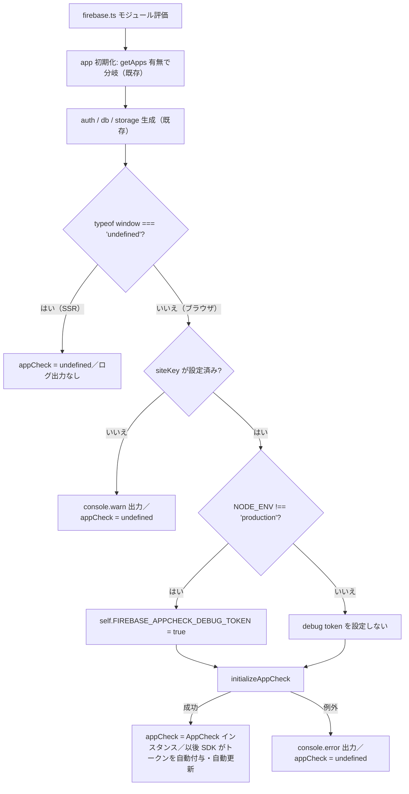

# たより — Firebase App Check（reCAPTCHA Enterprise）導入 設計書

| 項目 | 内容 |
|---|---|
| バージョン | v1.1 |
| 作成日 | 2026-09-05 |
| 最終更新日 | 2026-09-05（v1.1: プロバイダを reCAPTCHA Enterprise へ変更）|
| 作成者 | writer（Claude Code 開発チーム） |
| 承認者 | PM |
| 参照元 | docs/基本設計書.md v3.4（2.2 技術スタック / 2.3 環境変数 / 2.4 デプロイ構成 / 7 セキュリティ設計 / 8.3 認証エラー / 9.2 テスト方針）、docs/セットアップ手順書.md（章1 Firebase / 章2.4 環境変数 / 章3.2 Vercel環境変数）、docs/テスト仕様書.md v3.4（4.14 / 5.1 / 5.47 / 6.11）、.claude/rules/development.md、.claude/rules/nextjs-conventions.md、.claude/rules/restrictions.md |
| 対象実装 | `src/lib/firebase.ts`（App Check 初期化の追記）と `src/lib/firebase.test.ts`（既存テストのモック追加） |

---

## 目次

1. [背景](#1-背景)
2. [目的](#2-目的)
3. [対象範囲 / 対象外](#3-対象範囲--対象外)
4. [対象ファイル（画面 / API / モジュール）](#4-対象ファイル画面--api--モジュール)
5. [データ設計（環境変数・状態・初期化タイミング）](#5-データ設計環境変数状態初期化タイミング)
6. [実装方針（コード構造）](#6-実装方針コード構造)
7. [処理フロー](#7-処理フロー)
8. [エラー処理](#8-エラー処理)
9. [権限](#9-権限)
10. [Next.js 実装規約との整合](#10-nextjs-実装規約との整合)
11. [影響範囲](#11-影響範囲)
12. [ユーザー実施手順（Firebase Console / Vercel 側）](#12-ユーザー実施手順firebase-console--vercel-側)
13. [完了条件](#13-完了条件)
14. [変更履歴](#14-変更履歴)

---

## 1. 背景

「たより」は Vercel 上に公開された URL を持ち、ログイン画面（`/login`）は未認証で到達できる。現状、Firebase プロジェクトへのリクエストは「正規のたよりアプリから来たものか」を検証する仕組みを持たないため、以下のリスクが残っている。

- bot / クローラーがログイン画面へ自動アクセスし、Firebase Authentication のエンドポイントへ自動化リクエストを繰り返す。
- `NEXT_PUBLIC_FIREBASE_*`（クライアント公開前提。基本設計書 2.3）を抜き出した第三者スクリプトから、正規アプリ以外の経路で Firebase バックエンドを叩かれる。
- 無料枠運用（セットアップ手順書「無料枠に関する注意」）のため、自動化リクエストの増加はそのままコスト・クォータ枯渇リスクになる。

Firestore / Storage は Security Rules（基本設計書 7.1）で「アルバムメンバーのみ読み書き可」を担保済みだが、Rules は**認証済みユーザーの認可**を守るものであり、「そのリクエストが正規アプリから来たか」というアプリ正当性の検証はできない。この層を Firebase App Check（reCAPTCHA Enterprise）で補う。

### 1.1 reCAPTCHA Enterprise を採用する理由（v1.1）

当初（v1.0）は classic 版の reCAPTCHA v3 を前提に設計していたが、Firebase Console で App Check の Web アプリを新規登録する際、**classic 版 reCAPTCHA v3 が選択肢として提供されなくなっている**ことを確認した。Google が新規発行を reCAPTCHA Enterprise へ一本化する仕様変更を行ったためである。

そのため本設計ではプロバイダを **reCAPTCHA Enterprise**（スコアベース・不可視判定の WEB サイトキー）へ変更する。ユーザーは以下の条件で Google Cloud Console にてサイトキーを発行済みである。

| 項目 | 設定値 |
|---|---|
| 表示名 | tayori |
| プラットフォームの種類 | WEB |
| ドメイン | `tayori-chi.vercel.app`、`localhost` |
| チャレンジによる本人確認（checkbox 型）| いいえ（スコアベース＝不可視判定）|
| テストキー | いいえ |
| WAF 連携 | いいえ |

判定方式は classic v3 と同じ「ユーザーに見えないスコアベース判定」であり、**画面・操作体験は v1.0 の設計から変わらない**。

### 1.2 料金・運用上の前提（v1.1）

classic 版 reCAPTCHA v3 は完全無料だったが、reCAPTCHA Enterprise は **月間 10,000 アセスメントまで無料枠、それ以降は従量課金** となる。

- 「たより」は少人数のチーム利用（開発者1名＋関係者）を想定しており、ログイン試行を主対象とした評価回数は月10,000件を大きく下回るため、**無料枠内に収まる想定**である。
- Google Cloud プロジェクト側で **reCAPTCHA Enterprise API の有効化と課金アカウントの紐付け**が必要になる（無料枠内でも紐付け自体は必須）。手順は[12章](#12-ユーザー実施手順firebase-console--vercel-側)。
- enforcement 対象を Authentication のみに限定する方針（[3章](#3-対象範囲--対象外)）は、評価回数を抑えコストリスクを最小化する観点でも引き続き有効である。

## 2. 目的

- Firebase App Check（reCAPTCHA Enterprise）をクライアントへ組み込み、Firebase バックエンドへのリクエストに「正規のたよりアプリから発行された」ことを示す App Check トークンを付与する。
- enforcement（強制）の対象は **Firebase Authentication のみ** とし、bot / クローラーによるログイン画面経由の自動化リクエストを抑止する。
- reCAPTCHA Enterprise のスコアベースキーは**ユーザーに見えない裏側判定**であり、チェックボックス操作等の追加UIを発生させない（既存のログイン体験を変えない）。
- 開発環境では debug token により、reCAPTCHA の検証を経由せず従来どおりログイン・アップロードが行える状態を維持する。
- サイトキー未設定（開発初期・CI・テスト環境）でもアプリが起動し、テストが壊れない安全側の実装にする。

## 3. 対象範囲 / 対象外

### 対象範囲

| 区分 | 内容 |
|---|---|
| 初期化コード | `src/lib/firebase.ts` に App Check 初期化を追記（`auth` / `db` / `storage` と同じ**単一提供点**を維持） |
| プロバイダ | `ReCaptchaEnterpriseProvider`（reCAPTCHA Enterprise・スコアベースの不可視判定）。`isTokenAutoRefreshEnabled: true` |
| 開発環境対応 | `NODE_ENV` 分岐による debug token（`self.FIREBASE_APPCHECK_DEBUG_TOKEN = true`）の設定 |
| 環境変数 | `NEXT_PUBLIC_FIREBASE_RECAPTCHA_SITE_KEY` の新設（基本設計書 2.3 の一覧へ追記） |
| フォールバック | siteKey 未設定・SSR 評価・初期化例外の3経路で App Check を初期化せずアプリを継続する設計 |
| テスト | `firebase/app-check` を `vi.mock` した `src/lib/firebase.test.ts` の拡張（テスト仕様書 5.1 / 5.47） |
| ドキュメント | 基本設計書 2.3（環境変数）・セットアップ手順書（章2.4 / 章3.2）への追記 |

### 対象外

| 項目 | 理由 |
|---|---|
| チェックボックス型（本人確認チャレンジあり）の reCAPTCHA | PM確定仕様。ユーザーに見えない裏側判定（スコアベース）のみを採用する。Enterprise キー作成時の「チャレンジによる本人確認」は「いいえ」を選択済み |
| classic 版 reCAPTCHA v3 の利用 | Firebase Console の App Check Web アプリ登録で選択肢として提供されなくなったため採用不可（[1.1](#11-recaptcha-enterprise-を採用する理由v11)）|
| reCAPTCHA Enterprise のスコアしきい値チューニング・WAF 連携・アクションごとの評価 | MVP 対象外。キーは WAF 連携なしで作成済み。App Check は Firebase 側が既定のしきい値で判定する |
| Firestore / Storage の App Check enforcement | PM確定仕様。今回の enforcement 対象は Authentication のみ。必要になれば別タスクで追加（コード側の変更は不要で Console 操作のみ） |
| `firestore.rules` / `storage.rules` の変更 | 認可ロジックは不変。App Check は認可ではなくアプリ正当性検証（[9章](#9-権限)） |
| Firebase Console 側の enforcement 有効化・モード切替（モニター → 強制）| Console のワンクリック操作でコード修正が不要。ユーザーが実施（[12章](#12-ユーザー実施手順firebase-console--vercel-側)） |
| reCAPTCHA Enterprise サイトキーの発行作業・Google Cloud 側の API 有効化／課金アカウント紐付け | ユーザーが Google Cloud Console / Firebase Console で実施（実施済み）。コードはプレースホルダー前提で実装する |
| Vercel プレビュー環境（PR ごとに変わるドメイン）の reCAPTCHA ドメイン許可 | Console 側のドメイン登録の話であり、コード対応は不要。プレビューはトークン取得に失敗しうるが、モニターモードのため機能影響なし（[8章](#8-エラー処理) #5） |
| SEO 対応・検索インデックス化 | PM確定仕様で対象外 |
| App Check トークンのサーバー側検証（firebase-admin）| MVP期間は Client-side Firebase のみ（基本設計書 1.4 制約） |
| 利用者向けエラーメッセージの新設 | 新たな利用者向け失敗ケースが発生しない（[8章](#8-エラー処理)）。`src/lib/messages/*` は不変更 |

## 4. 対象ファイル（画面 / API / モジュール）

本タスクは**新規画面・新規 API を作らない**。変更は初期化モジュールと関連ドキュメントに閉じる。

| # | ファイル | 区分 | 変更内容 |
|---|---|---|---|
| 1 | `src/lib/firebase.ts` | 実装（既存変更）| App Check 初期化関数の追加と `appCheck` のエクスポート |
| 2 | `src/lib/firebase.test.ts` | テスト（既存変更）| `firebase/app-check` のモック追加、既存 FB-01〜03 の green 維持、新規 AC?-系ケース（テスト仕様書 5.47）の追加 |
| 3 | `.env.local`（ユーザー管理・Git 管理外）| 設定 | `NEXT_PUBLIC_FIREBASE_RECAPTCHA_SITE_KEY` の追加 |
| 4 | Vercel 環境変数 | 設定 | 同上（Production 環境）|
| 5 | `docs/基本設計書.md` 2.3 | ドキュメント | 環境変数一覧へ追記（writer 対応済み）|
| 6 | `docs/セットアップ手順書.md` 2.4 / 3.2 | ドキュメント | 7つ目の環境変数と App Check 有効化手順の参照を追記（writer 対応済み）|

**パッケージ追加は不要**。App Check は既存の `firebase` パッケージに同梱される `firebase/app-check` サブモジュールを import する（基本設計書 2.2 の技術スタックに変更なし）。

影響を受ける**画面**は「Firebase を利用する全画面」だが、**表示・操作は一切変更しない**（ログイン画面に reCAPTCHA バッジ等のUIを追加しない。reCAPTCHA Enterprise のバッジ表示は Google 提供の既定挙動に委ね、独自の非表示処理も行わない）。

## 5. データ設計（環境変数・状態・初期化タイミング）

### 5.1 環境変数

基本設計書 2.3 の `NEXT_PUBLIC_FIREBASE_*` 群に、7つ目として以下を追加する。

| 変数名 | 必須 | 値の例 | 用途 |
|---|---|---|---|
| `NEXT_PUBLIC_FIREBASE_RECAPTCHA_SITE_KEY` | 任意（未設定でも起動する）| `6Lxxxxxxxxxxxxxxxxxxxxxxxxxxxxxxxxxxxxxx` | **reCAPTCHA Enterprise のサイトキー**（表示名 tayori・WEB・スコアベース）。`ReCaptchaEnterpriseProvider` に渡す |

- **変数名は v1.0 から変更しない**。Enterprise のサイトキーをそのままこの変数へ格納する運用とし、`.env.local` / Vercel 環境変数 / 基本設計書 2.3 / セットアップ手順書の記述をすべて据え置くことで、リネームに伴う設定漏れ・デプロイ事故を避ける。
- 既存6変数と同じく `NEXT_PUBLIC_` プレフィックスを付ける（クライアントから参照するため。サイトキーは公開前提の値）。

#### 5.1.1 キーの性質（classic v3 との違い・v1.1）

| 観点 | classic reCAPTCHA v3（v1.0 の前提）| reCAPTCHA Enterprise（v1.1 の前提）|
|---|---|---|
| 必要なキー | サイトキー（クライアント用）＋ **シークレットキー**（Firebase Console の App Check 登録時に入力）の2種類 | **サイトキーのみ**。Firebase Console の App Check 登録でもサイトキーを入力する |
| シークレットキー | あり。サーバー側検証 API（`siteverify`）で使用 | **概念として存在しない**。サーバー側の検証は Google Cloud プロジェクトの reCAPTCHA Enterprise API 経由で Firebase 側が行うため、アプリが秘密値を保持しない |
| 発行場所 | reCAPTCHA 管理画面（`google.com/recaptcha/admin`）| Google Cloud Console → セキュリティ → reCAPTCHA（Enterprise）|
| クライアントへ置く値 | サイトキー（公開前提）| サイトキー（公開前提）|

> 秘密値をクライアントに置かない点は両者で同じであり、`NEXT_PUBLIC_` プレフィックスの妥当性は変わらない。むしろ Enterprise ではシークレットキーの保管・ローテーション運用そのものが不要になる。
- **未設定（`undefined` または空文字）を正常系の1つとして扱う**。値が未取得の期間・CI・ユニットテスト実行時に App Check を初期化せず、アプリとテストを壊さないため（[7.2](#72-sitekey-未設定時のフォールバック)）。
- 値はユーザーが `.env.local` および Vercel の Environment Variables に設定する。developer は値を知る必要がなく、プレースホルダー前提で実装する。

### 5.2 モジュールスコープの状態

| 名前 | 型 | 説明 |
|---|---|---|
| `app` | `FirebaseApp` | 既存。`getApps()` パターンで多重初期化を防止（変更なし）|
| `appCheck` | `AppCheck \| undefined` | **新設**。初期化に成功した場合のみ `AppCheck` インスタンス、SSR / siteKey 未設定 / 初期化例外時は `undefined` |

- `appCheck` は `auth` / `db` / `storage` と同様に `src/lib/firebase.ts` から **named export** する。単一提供点の原則を維持し、他モジュールが `initializeAppCheck` を直接呼ぶことを禁止する。
- 現時点で `appCheck` を参照する呼び出し元は存在しない（App Check は初期化するだけで SDK が自動的にトークンを付与するため）。将来 `getToken()` を明示的に呼ぶ必要が生じた場合の受け皿としてエクスポートする。
- 追加の React state・Context・Firestore フィールドは**一切導入しない**。`Album` / `AlbumMember` / `Media`（`src/types/index.ts`）、Firestore パス、Storage パス（`/albums/{albumId}/{mediaId}/{fileName}`）、`provider` フィールド設計に変更はない。

### 5.3 debug token の扱い

| 項目 | 内容 |
|---|---|
| 設定対象 | `self.FIREBASE_APPCHECK_DEBUG_TOKEN`（Firebase SDK が参照するグローバル変数）|
| 設定値 | `true`（SDK が debug token を自動生成し、ブラウザの DevTools コンソールへ出力する）|
| 設定条件 | `process.env.NODE_ENV !== 'production'`（development / test で設定、production では**設定しない**）|
| 設定順序 | **`initializeAppCheck()` を呼ぶ前**に設定する（SDK が初期化時にこの値を読むため、順序を誤ると debug token が効かない）|
| 型 | `self` を `{ FIREBASE_APPCHECK_DEBUG_TOKEN?: boolean \| string }` へキャストして代入する（`declare global` によるグローバル型汚染を避けるため）|
| 運用 | 初回起動時にコンソール出力された token を、ユーザーが Firebase Console の App Check → アプリ →「デバッグトークンを管理」へ登録する。token はブラウザに永続化されるため、以後は同一ブラウザで固定値として再利用される。開発者は1名のみのため個別 token の配布管理は行わない |

> 補足: 固定 token を環境変数（例: `NEXT_PUBLIC_FIREBASE_APPCHECK_DEBUG_TOKEN`）から注入する方式は、本タスクでは採用しない（PM確定仕様。開発者1名のため Console 登録運用で足りる）。将来チーム人数が増えた場合の拡張余地としてのみ記録する。

### 5.4 初期化タイミング

- `src/lib/firebase.ts` の**モジュール評価時**（既存の `auth` / `db` / `storage` と同じタイミング）に1回だけ実行する。
- `firebase.ts` はクライアントコンポーネント（`'use client'` の `page.tsx` / hooks / contexts）から import されるが、Next.js App Router ではクライアントコンポーネントのモジュールも**SSR 時にサーバー側で評価される**。App Check は `window` / `self` / DOM に依存するブラウザ専用 API のため、`typeof window === 'undefined'` のガードを必須とする（[7.1](#71-初期化シーケンス)）。
- `firebase.ts` 自体に `'use client'` は付けない（ライブラリモジュールであり、`'use client'` は境界を作る React コンポーネント側の責務。既存踏襲）。

## 6. 実装方針（コード構造）

`src/lib/firebase.ts` へ以下を追記する（既存の import・`firebaseConfig`・`app` / `auth` / `db` / `storage` は変更しない）。

```ts
import { initializeAppCheck, ReCaptchaEnterpriseProvider, type AppCheck } from 'firebase/app-check'
import type { FirebaseApp } from 'firebase/app'

// App Check（reCAPTCHA Enterprise）を初期化する。bot・クローラーによる自動化リクエストを
// Firebase Authentication 側で抑止するため、正規アプリから発行された証明トークンを
// リクエストへ自動付与させる目的で導入する（App Check導入設計書 2章）。
// ブラウザ専用APIのため SSR 評価時は何もせず、siteKey 未設定・初期化失敗時も
// アプリ起動を止めない（開発初期・CI で環境変数が無い状態を正常系として扱う）。
function setupAppCheck(firebaseApp: FirebaseApp): AppCheck | undefined {
  // SSR（サーバー側モジュール評価）では window/self が無いため初期化しない。
  if (typeof window === 'undefined') return undefined

  const siteKey = process.env.NEXT_PUBLIC_FIREBASE_RECAPTCHA_SITE_KEY
  if (!siteKey) {
    // 未設定は「App Check 無効で動かす」正常な運用状態のため、警告のみで継続する。
    console.warn(
      'App Check: NEXT_PUBLIC_FIREBASE_RECAPTCHA_SITE_KEY が未設定のため App Check を初期化しません。'
    )
    return undefined
  }

  // 開発・テスト環境では reCAPTCHA Enterprise の評価を経由せず debug token を使う。
  // SDK は initializeAppCheck 実行時にこの値を読むため、必ず初期化より前に設定する。
  if (process.env.NODE_ENV !== 'production') {
    ;(self as unknown as { FIREBASE_APPCHECK_DEBUG_TOKEN?: boolean | string })
      .FIREBASE_APPCHECK_DEBUG_TOKEN = true
  }

  try {
    return initializeAppCheck(firebaseApp, {
      // Enterprise 版もコンストラクタ引数はサイトキー1つで、classic v3 と同じインターフェース。
      provider: new ReCaptchaEnterpriseProvider(siteKey),
      // トークン期限切れによる認証失敗を防ぐため、SDK に自動更新させる。
      isTokenAutoRefreshEnabled: true,
    })
  } catch (error) {
    // reCAPTCHA スクリプトの読み込み失敗・重複初期化などで例外が出ても、
    // ログイン等の既存機能を止めないため握りつぶしてログのみ残す。
    console.error('App Check の初期化に失敗しました。App Check 無効のまま継続します。', error)
    return undefined
  }
}

export const auth = getAuth(app)
export const db = getFirestore(app)
export const storage = getStorage(app)
export const appCheck = setupAppCheck(app)
export { app }
```

実装上の遵守事項（`.claude/rules/development.md`）:

- トップレベル関数 `setupAppCheck` は **`function` 宣言**で定義する（アロー関数にしない）。
- 「何を・なぜ」を説明するコメントを関数先頭と各分岐に付ける。処理の言い換えではなく背景（bot 抑止 / SSR 回避 / 起動継続）を書く。
- 共通化の判断: App Check 初期化は `firebase.ts` の1箇所のみで使用するため、別ファイル（`src/lib/appCheck.ts` 等）へは切り出さない。auth / db / storage と同じ「Firebase の初期化とサービスインスタンスの単一提供点」という同一の変更理由を共有するため、同一ファイルに置く（共通化チェックリスト 3「変更トリガーが同じ」に合致）。
- `appCheck` の export 名は既存の `auth` / `db` / `storage` と同じ小文字キャメルケースに揃える。
- プロバイダは `firebase/app-check` の `ReCaptchaEnterpriseProvider` を使う。`ReCaptchaV3Provider` は import しない（v1.1 変更点。両者は `new Xxx(siteKey)` という同一シグネチャのため、置換以外の実装変更は不要）。

## 7. 処理フロー

### 7.1 初期化シーケンス



処理手順（番号付き）:

1. `firebase.ts` が import され、既存どおり `app` / `auth` / `db` / `storage` を生成する。
2. `setupAppCheck(app)` を呼ぶ。
3. `typeof window === 'undefined'`（SSR）なら何もせず `undefined` を返す（ビルドログを汚さないため警告も出さない）。
4. `process.env.NEXT_PUBLIC_FIREBASE_RECAPTCHA_SITE_KEY` を読む。未設定（`undefined` / 空文字）なら `console.warn` を1回出して `undefined` を返す。
5. `process.env.NODE_ENV !== 'production'` の場合、`self.FIREBASE_APPCHECK_DEBUG_TOKEN = true` を設定する（`initializeAppCheck` より**前**）。
6. `initializeAppCheck(app, { provider: new ReCaptchaEnterpriseProvider(siteKey), isTokenAutoRefreshEnabled: true })` を実行する。
7. 成功時は `AppCheck` インスタンスを `appCheck` として export する。以降、Firebase SDK が Authentication などへのリクエストへ App Check トークンを自動付与し、期限前に自動更新する（アプリ側の追加実装は不要）。
8. 例外時は `console.error` を出して `undefined` を返し、アプリはそのまま起動を続ける。

### 7.2 siteKey 未設定時のフォールバック

| 実行環境 | siteKey | 挙動 |
|---|---|---|
| ローカル開発（`npm run dev`）| 未設定 | `console.warn` のみ。App Check 無効。ログイン・アップロード等は従来どおり動作 |
| ローカル開発 | 設定済み | debug token が有効になり、Console 登録済み token で検証をパスして従来どおり動作 |
| ユニットテスト（Vitest / jsdom）| 未設定（`vi.stubEnv` で明示的に空にするケースを含む）| `initializeAppCheck` を呼ばない。既存 FB-01〜03 は影響を受けない |
| 本番（Vercel）| 未設定 | `console.warn` のみ。App Check トークンが付かないが、**モニターモード運用のため Auth リクエストは成功する**（enforcement を有効化した後は失敗しうる → [12章](#12-ユーザー実施手順firebase-console--vercel-側) の切替前チェック） |
| 本番（Vercel）| 設定済み | reCAPTCHA Enterprise のスコアベース（不可視）判定でトークンを取得し、Auth リクエストへ自動付与 |

### 7.3 debug token 分岐の判定境界

| `NODE_ENV` | debug token 設定 | 想定 |
|---|---|---|
| `'development'` | する | `npm run dev` |
| `'test'` | する | Vitest 実行時（ただし siteKey 未設定なら 4 で早期 return するため実際には到達しないことが多い）|
| `'production'` | **しない** | `npm run build` 後の本番・Vercel |
| 未定義 / 想定外の値 | する（`!== 'production'` のため）| 安全側: 本番以外は debug 扱い。production 判定は完全一致のみとする |

## 8. エラー処理

App Check の失敗は**利用者操作の失敗ではない**ため、原則として画面へメッセージを出さず開発者向けログに留める。`src/lib/messages/*`（`ERROR_MESSAGES` 等）への**キー追加は行わない**。

| # | ケース | 検知箇所 | 挙動 | 出力（開発者向けログ）|
|---|---|---|---|---|
| 1 | SSR でモジュール評価された | `typeof window === 'undefined'` | 何もせず `undefined` を返す | なし（ビルドログのノイズを避けるため）|
| 2 | siteKey 未設定・空文字 | `if (!siteKey)` | App Check を初期化せず起動継続 | `console.warn('App Check: NEXT_PUBLIC_FIREBASE_RECAPTCHA_SITE_KEY が未設定のため App Check を初期化しません。')` |
| 3 | `initializeAppCheck` が例外を投げた（reCAPTCHA Enterprise スクリプト読込失敗・重複初期化・不正な siteKey 形式 等）| `try / catch` | 例外を握りつぶし `undefined` を返す。ログイン等は継続 | `console.error('App Check の初期化に失敗しました。App Check 無効のまま継続します。', error)` |
| 4 | 実行時のトークン取得失敗（reCAPTCHA Enterprise のスコア判定失敗・ネットワーク断）| Firebase SDK 内部 | アプリ側で捕捉しない。モニターモードでは Auth リクエストは成功するため利用者影響なし | SDK が出力するコンソールエラーのみ |
| 5 | 未許可ドメインからのアクセス（Vercel プレビュー等）| Firebase SDK 内部 / reCAPTCHA Enterprise | 同上。モニターモードのため機能影響なし。許可済みドメインは `tayori-chi.vercel.app` と `localhost` のみ | SDK が出力するコンソールエラーのみ |
| 7 | Google Cloud 側で reCAPTCHA Enterprise API が未有効化／課金アカウント未紐付け（v1.1 追加）| Firebase SDK 内部 / reCAPTCHA Enterprise | アプリ側で捕捉しない（ケース3または4と同じ経路で失敗する）。モニターモードのため利用者影響なし。ユーザーが Cloud Console 側で有効化して復旧する（[12章](#12-ユーザー実施手順firebase-console--vercel-側)）| SDK が出力するコンソールエラーのみ |
| 8 | 無料枠（月10,000アセスメント）超過による課金・スロットリング（v1.1 追加）| Google Cloud 側 | 想定規模では発生しない見込み（[1.2](#12-料金運用上の前提v11)）。発生時もモニターモードでは利用者影響なし。Cloud Console の使用量アラートでユーザーが検知する | アプリ側の出力なし |
| 6 | 将来 enforcement を「強制」に切り替えた後にトークンが無効 | Auth SDK が `signInWithPopup` / `signInWithRedirect` を reject | 既存の `getAuthErrorMessage(code)` の default 分岐に落ち、`ERROR_MESSAGES.AUTH_SIGNIN_FAILED` を表示（基本設計書 8.3 のマッピングは**不変更**）| 既存のログイン画面エラー表示 |

> 設計判断: App Check 固有のエラーコードに対する専用文言は追加しない。理由は (a) モニターモード運用では利用者に見える失敗が発生しない、(b) 強制モード切替後の失敗はログイン失敗として既存の汎用文言で十分伝わる、(c) 文言追加は `src/lib/messages/` の一元管理方針（メッセージ定数設計書 v1.0）に沿って必要になった時点で別タスクとして扱うほうが安全なため。

## 9. 権限

App Check は**認可（Authorization）ではなくアプリ正当性の検証（Attestation）**である。したがって「誰が何をできるか」のモデル（viewer / editor / admin / owner）には一切影響しない。

| 観点 | 内容 |
|---|---|
| ロールによる差異 | なし。viewer / editor / admin / owner のいずれも App Check の初期化・トークン付与は同一 |
| 未ログインユーザー | ログイン前（`/login` 表示時点）から App Check は初期化される。これは「ログイン試行そのもの」を bot から守るために必要 |
| 認可の担保 | 従来どおり Firebase Security Rules（基本設計書 7.1: `memberUids` / `adminUids` による判定）が担う。`firestore.rules` / `storage.rules` は**変更しない** |
| enforcement 範囲 | Authentication のみ。Firestore / Storage は enforcement 対象外のため、App Check トークンが無くても既存の読み書きは Rules の判定どおりに動作する |
| App Check 未初期化時 | siteKey 未設定・初期化失敗でもログイン・閲覧・投稿の可否は変わらない（モニターモード前提）|
| 将来 enforcement を強制にした場合 | 「正規アプリからのリクエストか」の判定が追加されるだけで、アルバムごとの権限判定は不変。ロール別の挙動差は生じない |

## 10. Next.js 実装規約との整合

`.claude/rules/nextjs-conventions.md` の各項目に対する本タスクの立場を明示する。

| 規約 | 本タスクでの扱い |
|---|---|
| 1. フォント（`next/font/google`）| 該当なし（フォント追加・変更なし）|
| 2. `loading.tsx` / `error.tsx` / `not-found.tsx` | 該当なし（新規ルートセグメントを追加しない。App Check の失敗は画面表示を伴わないため、専用のエラーUIも作らない）|
| 3. Server / Client Components | `src/lib/firebase.ts` はコンポーネントではないライブラリモジュールのため `'use client'` を付けない（既存踏襲）。**新たな例外の追加なし**。ただし本モジュールは SSR 時にもサーバー側で評価されうるため、ブラウザ専用 API を触る App Check 初期化のみ `typeof window === 'undefined'` でガードする（[5.4](#54-初期化タイミング)）。この方針を採る理由は、`'use client'` を付けてもサーバー側でのモジュール評価自体は避けられないためである |
| 4. 画像表示（`next/image`）| 該当なし（画像表示の追加なし。reCAPTCHA Enterprise のバッジは Google のスクリプトが描画するため `next/image` 対象外）|

## 11. 影響範囲

### 11.1 コードの依存関係

`src/lib/firebase.ts` は `auth` / `db` / `storage` の単一提供点であり、多数のモジュールから import されている。今回の変更は**既存 export の追加のみ**（`appCheck` の新規 export）で、`auth` / `db` / `storage` / `app` のシグネチャ・生成順序は変えないため、呼び出し側の修正は不要（後方互換）。

| 影響区分 | 対象 | 影響内容 |
|---|---|---|
| 直接変更 | `src/lib/firebase.ts` | App Check 初期化の追記（副作用が1つ増える）|
| 直接変更 | `src/lib/firebase.test.ts` | `firebase/app-check` の `vi.mock` 追加が必要（モック対象は `initializeAppCheck` と `ReCaptchaEnterpriseProvider`）。未追加のままだと実 SDK が読み込まれ FB-01〜03 が不安定化しうる |
| 間接影響 | `src/lib/auth.ts` / `src/contexts/AuthContext.tsx` / 各 `hooks/*` / 各 `page.tsx` | import 経由で App Check 初期化の副作用が走る。API は不変のためコード修正は不要 |
| 間接影響 | `firebase.ts` をモックせず import する既存テスト | jsdom 環境では `typeof window !== 'undefined'` のため App Check 初期化パスへ入る。**siteKey 未設定なら早期 return するため実害なし**。ただし `firebase/app-check` を明示的にモックしないテストがある場合は、実 SDK の読み込みで失敗しうるため確認が必要 |
| 影響なし | 環境変数名 `NEXT_PUBLIC_FIREBASE_RECAPTCHA_SITE_KEY`（v1.1）| 変数名は据え置き。`.env.local` / Vercel / 基本設計書 2.3 / セットアップ手順書の設定作業は不要（格納する値のみ Enterprise のサイトキーへ差し替える）|
| 影響なし | `firestore.rules` / `storage.rules` / `firestore.indexes.json` | 変更しない |
| 影響なし | `src/types/index.ts` / Firestore・Storage のデータ構造 / `provider` 設計 | 変更しない |

> `.claude/rules/restrictions.md` セクション3に従い、developer は着手前に「`firebase.ts` を import している全ファイル」「`firebase/app-check` をモックしていない既存テスト」を検索し、依存関係レポートを提示すること。

### 11.2 リグレッションテスト対象（機能）

| # | 機能 | 確認内容 |
|---|---|---|
| 1 | Googleログイン（PC・ポップアップ）| `signInWithPopup` 経路が従来どおり成功し `/` へ遷移する |
| 2 | Googleログイン（モバイル・リダイレクト）| `signInWithRedirect` → `getRedirectResult` → `returnUrl` 復元の一連が従来どおり動作する（基本設計書 6.1.1）|
| 3 | ホームのアルバム一覧購読 | `useAlbums`（`onSnapshot`）が従来どおり取得・更新される |
| 4 | アルバム詳細のメディア購読 | `useAlbum` / `useMediaList` / `useMedia` が従来どおり動作する |
| 5 | アップロード | `uploadBytesResumable` の進捗・完了・Firestore 反映が従来どおり動作する |
| 6 | 権限管理・招待受諾 | `writeBatch` による members / memberUids / adminUids 更新が従来どおり成功する |
| 7 | 開発環境（`npm run dev`）| debug token 設定下でも 1〜6 がすべて動作する |
| 8 | 既存テストスイート全体 | 第1〜第11フェーズの全テストが green を維持する |

## 12. ユーザー実施手順（Firebase Console / Vercel 側）

コード実装では完結せず、ユーザーの Console 操作が必要な作業を明記する（developer は実施しない）。**v1.1 で手順 1〜2 を reCAPTCHA Enterprise 用に全面差し替えした**（classic 版の `google.com/recaptcha/admin` での v3 キー発行手順は廃止）。

1. **Google Cloud 側の準備（Enterprise 固有・v1.1 追加）**: Firebase プロジェクトと同一の Google Cloud プロジェクトを選択し、以下を実施する。
   1. **課金アカウントの紐付け**: Cloud Console → お支払い。無料枠（月10,000アセスメント）内でも課金アカウントの紐付けが必須である。
   2. **reCAPTCHA Enterprise API の有効化**: Cloud Console → APIとサービス → ライブラリ →「reCAPTCHA Enterprise API」を有効化する。
2. **reCAPTCHA Enterprise サイトキーの発行**: Cloud Console → セキュリティ → reCAPTCHA →「キーを作成」で以下を指定する（**実施済み**）。
   | 設定項目 | 値 |
   |---|---|
   | 表示名 | `tayori` |
   | プラットフォームの種類 | ウェブサイト（WEB）|
   | ドメイン | `tayori-chi.vercel.app`、`localhost` |
   | チャレンジによる本人確認を使用する | いいえ（スコアベースの不可視判定にするため）|
   | テストキーとして使用する | いいえ |
   | WAF 機能の利用 | いいえ |

   作成後に表示される **サイトキー（`6L...`）を控える**。Enterprise には**シークレットキーが存在しない**ため、控える値はサイトキー1つのみである（[5.1.1](#511-キーの性質classic-v3-との違いv11)）。
   **Vercel プレビュー環境（PR ごとに変わるドメイン）は登録対象外**とする（[3章 対象外](#対象外)）。
3. **Firebase Console への登録**: Firebase Console → App Check → アプリ → 対象 Web アプリを選択し、プロバイダに **reCAPTCHA Enterprise** を選び、手順2のサイトキーを入力して登録する。
4. **環境変数の設定**: `.env.local` と Vercel の Environment Variables（Production）へ `NEXT_PUBLIC_FIREBASE_RECAPTCHA_SITE_KEY` として**手順2の Enterprise サイトキー**を設定する（**変数名は v1.0 から変更なし**）。Vercel は再デプロイで反映される。
5. **debug token の登録**: `npm run dev` 実行後、DevTools コンソールに出力された App Check debug token を Firebase Console → App Check → アプリ →「デバッグトークンを管理」へ登録する（開発機ごとに1回）。
6. **モニターモードで観測**: Firebase Console → App Check → API（Authentication）の指標で、検証済み / 未検証リクエストの比率を確認する。**この期間は enforcement を有効化しない**。
7. **enforcement 有効化（強制）**: 未検証リクエストが十分に少ないことを確認したうえで、Authentication のみ「強制」へ切り替える。切替前に「本番の環境変数が設定済みであること」（[7.2](#72-sitekey-未設定時のフォールバック) の本番×未設定行）を必ず確認する。切替はコード修正を伴わない。
8. **切戻し**: 強制モードでログイン不能が発生した場合は、Console から「モニター」へ戻すことで即時に復旧できる（デプロイ不要）。
9. **使用量の監視（Enterprise 固有・v1.1 追加）**: Cloud Console → reCAPTCHA → 指標、またはお支払いの予算アラートで、月間アセスメント数が無料枠（10,000件）内に収まっていることを定期的に確認する（[1.2](#12-料金運用上の前提v11)）。

## 13. 完了条件

- [ ] `src/lib/firebase.ts` に App Check 初期化が追記され、`initializeAppCheck(app, { provider: new ReCaptchaEnterpriseProvider(siteKey), isTokenAutoRefreshEnabled: true })` が呼ばれる。
- [ ] プロバイダが `ReCaptchaEnterpriseProvider` であり、`ReCaptchaV3Provider` が import されていない（v1.1）。
- [ ] `isTokenAutoRefreshEnabled: true` が指定されている。
- [ ] `appCheck` が `src/lib/firebase.ts` から export され、他モジュールが `initializeAppCheck` を直接呼んでいない（単一提供点の維持）。
- [ ] `typeof window === 'undefined'` のガードにより SSR 評価時に初期化されない。
- [ ] siteKey 未設定（`undefined` / 空文字）でも例外を投げず、`console.warn` のみでアプリ起動が継続する。
- [ ] `NODE_ENV !== 'production'` のときのみ `self.FIREBASE_APPCHECK_DEBUG_TOKEN = true` が `initializeAppCheck` より前に設定される。
- [ ] `initializeAppCheck` が例外を投げてもアプリがクラッシュしない（`try/catch` で `console.error` のみ）。
- [ ] 環境変数 `NEXT_PUBLIC_FIREBASE_RECAPTCHA_SITE_KEY` が基本設計書 2.3 / セットアップ手順書に記載され、実装がその名前を参照している（v1.1 でも変数名は不変。値のみ Enterprise サイトキー）。
- [ ] テスト仕様書 5.1（改訂）・5.47（新設）のケースが実装され、カバレッジ 90% 以上を維持している（未達時は理由・リスク・追加テスト方針を PM へ報告）。
- [ ] 既存のログインフロー（ポップアップ / リダイレクト、PC / モバイル）・一覧購読・メディア購読・アップロード・権限管理に回帰がない（[11.2](#112-リグレッションテスト対象機能)）。
- [ ] `firestore.rules` / `storage.rules` / データ型 / `provider` 設計が変更されていない。
- [ ] `src/lib/messages/*` に新規キーが追加されていない（利用者向け文言の追加なし）。

## 14. 変更履歴

| バージョン | 日付 | 変更者 | 内容 |
|---|---|---|---|
| v1.1 | 2026-09-05 | writer | **プロバイダを classic reCAPTCHA v3 から reCAPTCHA Enterprise へ変更**。変更理由: Firebase Console の App Check Web アプリ新規登録で classic 版 reCAPTCHA v3 が選択できなくなっており（Google が新規発行を Enterprise へ一本化する仕様変更）、ユーザーが Google Cloud Console でスコアベースの WEB サイトキー（表示名 tayori／ドメイン `tayori-chi.vercel.app`・`localhost`／本人確認チャレンジなし／テストキーなし／WAF なし）を作成・登録したため。変更点: (1) 実装プロバイダを `ReCaptchaV3Provider` → `ReCaptchaEnterpriseProvider`（`firebase/app-check` から import、`new ReCaptchaEnterpriseProvider(siteKey)` で classic v3 と同一インターフェース）へ変更（3章・6章・7.1・13章）、(2) キーの性質の説明を追加（5.1.1: Enterprise はサイトキーのみでシークレットキーの概念がなく、サーバー側検証は Google Cloud の reCAPTCHA Enterprise API 経由）、(3) 料金・運用前提を追記（1.2: 月10,000アセスメントまで無料枠・以降従量課金、tayori 規模では無料枠内の想定）、(4) ユーザー実施手順を Google Cloud Console でのキー作成手順へ置換し、reCAPTCHA Enterprise API の有効化・課金アカウント紐付け・使用量監視を追加（12章）、(5) Enterprise 固有の失敗ケース（API 未有効化・無料枠超過）をエラー処理へ追加（8章 #7・#8）。**据え置き**: 環境変数名 `NEXT_PUBLIC_FIREBASE_RECAPTCHA_SITE_KEY`（Enterprise サイトキーをそのまま格納。説明文のみ追記）、enforcement 対象は Authentication のみ、debug token・SSR ガード・siteKey 未設定時フォールバック・`try/catch` によるエラー握りつぶし、環境変数が任意（未設定でも起動）という設計方針。テスト仕様書 4.14 / 5.47 / 6.11 のモック対象クラス名も同時に更新。 |
| v1.0 | 2026-09-05 | writer | 新規作成。Firebase App Check（reCAPTCHA v3）導入の設計を定義（PM整理済み要件に準拠）。enforcement 対象は Authentication のみ、Firestore/Storage・Security Rules は対象外。`src/lib/firebase.ts` への初期化追記（単一提供点維持・`function` 宣言・`appCheck` export）、SSR ガード（`typeof window === 'undefined'`）、siteKey 未設定時の `console.warn` フォールバック、`NODE_ENV !== 'production'` での debug token 設定（`initializeAppCheck` より前）、`try/catch` による初期化例外の握りつぶしを規定。環境変数 `NEXT_PUBLIC_FIREBASE_RECAPTCHA_SITE_KEY` を新設し基本設計書 2.3・セットアップ手順書へ反映。利用者向けメッセージは追加せず 8.3 マッピングも不変更。テスト仕様書 v3.3（5.1 改訂 / 5.47 新設 / 6.11）と整合。 |
