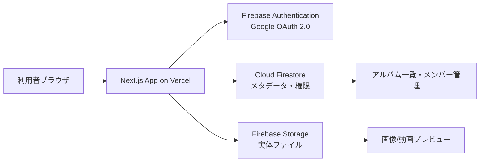

# たより — 基本設計書

| 項目 | 内容 |
|---|---|
| バージョン | v2.3 |
| 作成日 | 2026-06-22（v1.1: 2026-07-09 非機能要件にセキュリティ運用を追加 / v1.2: 2026-07-09 コンポーネント構成をAtomic Designへ変更 / v1.3: 2026-07-14 ログイン後・ログイン済みアクセス時のリダイレクトを `router.push` から `router.replace` に統一。ブラウザ履歴に `/login` を残さず「戻る」操作でログイン画面へ戻れる問題を防ぐため。実装は `router.replace()` を採用済み、テスト仕様書LP-02〜04も `replace` 呼び出しで検証済み / v1.4: 2026-07-14 レビュワー承認後の軽微な差戻し対応として、実装・テスト仕様書との整合のため2点を修正。(1) 6.2節アルバム作成の手順6のエラー文言を「アルバムの作成に失敗しました。時間をおいて再試行してください。」から8.1節#6の一覧文言「保存に失敗しました。時間をおいて再試行してください。」へ統一（実装・テスト仕様書は8.1 #6の文言で確定済みのため）。(2) 4.4節ホームのデータ取得コード例を `where('members', 'array-contains', { uid: currentUser.uid })` から同節「注意」の推奨方式 `where('memberUids', 'array-contains', currentUser.uid)` へ修正（実装は `memberUids` ベースで統一しており、型定義5.1・Security Rules 7.1とも整合するため） / v1.5: 2026-07-14 本番デプロイで実際に発生した`FirebaseError: Function addDoc() called with invalid data. serverTimestamp() is not currently supported inside arrays`を受け、6.2節アルバム作成コード例の`members`配列内`joinedAt`を`serverTimestamp()`から`Timestamp.now()`へ修正（Firestoreは配列要素内でのserverTimestamp()を許可しないため。実装 `src/lib/firestoreAlbum.ts` も同様に修正済み） / v1.6: 2026-07-14 developerからの軽微差分申し送りを反映。4.7節アップロード画面のコンポーネント構成に、page層のクライアントバリデーション結果を保持する任意prop `fileErrors: Record<string, string>`（ファイル名→メッセージ）によるインラインエラー表示（非対応形式・サイズ超過で開始前に弾かれたファイル）の仕組みを追記。アップロード中のエラー（`UploadItem.errorMessage`）とバリデーションエラー（`fileErrors`）で表示手段を区別する旨を明確化。実装で `UploadTemplate` に追加された任意prop `fileErrors` に対応。テスト仕様書v1.4（§5.30）と整合） / v1.7: 2026-07-14 実装との型不一致をレビューで指摘され修正。4.7節アップロード画面の `fileErrors` の型記載を `Record<string, string>` から実装（`src/components/templates/UploadTemplate.tsx`）の実態である `fileErrors?: FileValidationError[]`（`{ fileName: string; message: string }[]` の配列形式）へ修正。テスト仕様書v1.5（§5.30）と整合） / v1.8: 2026-07-22 アップロード画面のフローを「ファイル選択→即アップロード開始」から「ファイル選択→確定前プレビュー一覧→『保存』ボタン押下で一括アップロード開始」へ変更（PM指示）。4.7節: 確定前状態 `pending` を新設（`UploadStatus` を6状態化）し状態遷移図を更新、`waiting` との違いを明記。サムネイル表示仕様（画像プレビュー/動画は再生アイコン付き）、確定前行のチェックボックス＋「選択項目を削除」ボタン・「保存」ボタンをコンポーネント構成に追加。`UploadItem` interface に `selected?`/`previewUrl?` を追加。「保存」ボタン活性条件（`pending` 1件以上）と全件削除時の扱い（**非活性=disabled、表示維持**：操作起点の喪失防止・レイアウト安定を優先）を明記。アップロード成功フィードバック改善（done行の成功トーン強調＋全件完了バナー）を具体化。各層props（UploadItem/UploadList/UploadTemplate）を新フロー用に定義。6.3節: フローをフェーズ1（選択→pending一覧）／フェーズ2（確定前のローカル削除、Firestore/Storage実削除API不使用）／フェーズ3（保存押下→既存 `uploadBytesResumable` 並列処理を踏襲）へ書き換え。保存後の再編集は対象外。8.1節: 新規エラーケースが無いため不変更。テスト仕様書v1.6と整合） / v1.9: 2026-07-22 権限管理画面（共有設定）の設計を確定（PM指示）。4.8節: コンポーネント構成をAtomic Design層（permissions/page.tsx → PermissionsTemplate → PermissionTable/MemberRow・ActionRow・InviteModal）で再定義。InviteModalの2導線（①URLコピー・②メールアドレス招待）、招待中「招待中」バッジ表示、招待取り消し操作を追加。確定済みメンバー削除ボタン・RecentActivitySection（権限変更履歴）・一括編集は次フェーズ対象外と明記。5.1節: `AlbumMember.invited?: boolean`（UI表示専用）を追加、`albums/{albumId}/pendingInvites/{email}` サブコレクションと `PendingInvite` 型を新規定義。ドキュメントIDは正規化済みメール（`.trim().toLowerCase()`）とし、保存経路・照合経路の双方で正規化を統一適用する旨を明記。6.6/6.7節: メール事前登録→ログイン時受諾（acceptPendingInvite/useAcceptInviteで403判定前に実行・writeBatchで members/memberUids へ arrayUnion + pendingInvites 削除）の全体フローと招待取り消しフローを追記。同一メール再招待時は invitedAt を毎回上書き。7.1節: `isAlbumAdmin`（ownerId一致 or members の canManage==true 存在）、`isAcceptingOwnInvite`（本人メール正規化一致の招待存在・members/memberUids のappend等価比較・権限値をget()で強制取得し自称昇格を禁止・title/ownerIdの最小限ロック）、`allow update` の置換、`pendingInvites` サブコレクションの create/update/delete/read 権限をルール文言案として明記。テスト仕様書v1.7と整合。招待取り消しは pendingInvites ドキュメント削除のみで確定メンバー削除は非対象（restrictions.md 非抵触）） / v2.0: 2026-07-22 権限管理のFirestore Rules設計バグ（配列に対する `members.exists(m, ...)` 構文がFirestore Rules言語仕様に存在せず、エミュレータで `Function not found error: Name: [exists]` の評価エラーが発生）を受け、developerの実装済み修正に合わせてドキュメントを追従。`Album` 型に非正規化フィールド `adminUids: string[]`（`members` の `canManage===true` の uid を常に反映）を追加。5.1節: `adminUids` フィールドと設計意図の注記を追加。6.2節: `createAlbum` に `adminUids: [uid]` を追記（owner は常に含める）。4.8節・6.7節保存フロー: `members` の `canManage` から `adminUids` を再算出して同時保存する旨を追記。6.7節受諾フロー: 招待が `canManage:true` の場合のみ受諾者 uid を `adminUids` へ `arrayUnion` する旨を追記。7.1節: `isAlbumAdmin` を「`ownerId` 一致 or `uid in adminUids`（`get('adminUids', [])` による後方互換アクセス）」へ修正し、以前の owner 限定縮退記述を廃止。`isAcceptingOwnInvite` に `affectedKeys().hasOnly(['members','memberUids','adminUids','updatedAt'])` のフィールドホワイトリストと、`canManage:true` 時のみ `adminUids` append・それ以外不変の検証を追加（viewer/editor 招待での adminUids 経由の権限昇格を拒否）。移行スクリプトは不要（既存ドキュメントは `get(...,  [])` のデフォルト空配列で評価）。テスト仕様書v1.8と整合） / v2.1: 2026-07-23 7.1節 `isAcceptingOwnInvite` のコードサンプルを実装 `firestore.rules` と完全一致させる修正（developer指摘）。(1) `affectedKeys().hasOnly([...])` から `'updatedAt'` を削除し `['members', 'memberUids', 'adminUids']` へ修正（実装は `updatedAt` を許可しない安全側であり、受諾時に `updatedAt` だけを書き換えても拒否されることを検証するテスト仕様書 RUL-06c と一致させるため）。(2) 関数シグネチャを設計サンプル固有の `isAcceptingOwnInvite(albumId, resource, request)` から実装どおりの `isAcceptingOwnInvite(albumId)`（`request`/`resource` は暗黙参照）へ修正し、`allow update` 呼び出し側も `isAcceptingOwnInvite(albumId)` へ揃える。あわせて関数本体の記述順・コメントを実装へ転記し、git diff レベルで一致させた。ロジック・権限判定の実質変更は無し） / v2.2: 2026-07-23 メディアプレビュー単体画面（`/albums/[albumId]/media/[mediaId]`）の新規実装（既知の404不具合解消）と、アルバム詳細画面から権限管理画面へのUI導線追加を確定（PM指示）。4.9節: タイトルにURLパスを明記し、「アクセス条件」欄（memberUidsに自分のUIDが含まれる場合のみ・非メンバーは403・存在しないmediaIdは404相当）を4.6節と統一文言で追加。前後ナビゲーションは不採用（含めない）と明記。動画プレビューの実装方針を追記（`controls` によるブラウザネイティブ再生UI採用・独自プレイヤー非実装、`preload="metadata"` による初期表示速度優先の理由、画像/動画分岐は既存 `media.contentType` を判定基準とし新規フィールド追加なし、想定外 contentType 時はダウンロードリンク主導のフォールバック）。4.6節: ページヘッダーの「権限管理」リンクを `myMember?.canManage === true` のときのみ表示する条件を追記。判定は `page.tsx` 側で算出し `AlbumDetailTemplate` へ `canManage: boolean` propで渡す方針（atomic-design.md のtemplates層制約に整合）と、非表示時は遷移不可である旨を明記。テスト仕様書v1.9と整合） / v2.3: 2026-07-23 メッセージ文言一元管理タスク（PM指示）に伴い 8.1節末尾にクロスリファレンス注記を追加。利用者向けメッセージ文言を `src/lib/messages/`（errorMessages/successMessages/confirmMessages）へ定数集約する方針と、詳細（キー命名・関数形式パラメータ・移行前後マッピング・`POST_FORBIDDEN` を別キーとする判断・`getAuthErrorMessage` の内部文字列のみ置換パターン）を新規 `docs/メッセージ定数設計書.md` v1.0 へ委譲する旨を明記。8.1表 #2（セッション切れ）・#8（メディア読み込みエラー）は未実装のため今回の定数化対象外とする注記を追加。エラー文言の値・表示条件は不変（キー化のみ）。テスト仕様書v2.0（§5.43）と整合） |
| 作成者 | writer（Claude Code 開発チーム） |
| 承認者 | PM |
| 参照元 | docs/画像・動画共有アプリ 機能一覧.md / docs/画像・動画共有アプリ構想メモ.md / layouts/heritage_heart/DESIGN.md / layouts/8._pc_3/code.html |

---

## 目次

1. [文書概要](#1-文書概要)
2. [システムアーキテクチャ](#2-システムアーキテクチャ)
3. [デザインシステム（Heritage & Heart）](#3-デザインシステムheritage--heart)
4. [画面設計](#4-画面設計)
5. [データ設計](#5-データ設計)
6. [機能設計](#6-機能設計)
7. [セキュリティ設計](#7-セキュリティ設計)
8. [エラー処理設計](#8-エラー処理設計)
9. [非機能要件](#9-非機能要件)
10. [プロジェクト構成・後回し機能](#10-プロジェクト構成後回し機能)
- [付録: レビューチェックリスト](#付録-レビューチェックリスト)

---

## 1. 文書概要

### 1.1 目的

本書は、画像・動画共有アプリ「たより」のMVP開発において、developerが迷わず実装を開始できる粒度の設計情報を1ファイルに集約したものである。docs/ と layouts/ に分散していた構想・デザインシステム・画面モックアップの情報を統合し、実装判断に必要なデータ型・処理フロー・エラー処理・権限モデルを明文化する。

### 1.2 スコープ（対象）

| カテゴリ | 内容 |
|---|---|
| MVP機能 | ログイン・アルバム作成/一覧・アップロード・進捗表示・グリッド表示・プレビュー・共有リンク・権限管理（8機能） |
| 対象画面 | 5画面（ログイン / ホーム / アルバム詳細 / アップロード / 権限管理） |
| レスポンシブ | モバイルファースト + PC対応 |
| インフラ | Firebase（Auth / Firestore / Storage） + Vercel |

### 1.3 対象外

以下はMVP後回しとする（[セクション10](#10-プロジェクト構成後回し機能) に詳細記載）。

- コメント機能
- 既読/未読管理
- AIタグ付け・AI検索
- 動画変換・圧縮・サムネイル自動生成
- Cloudinary / Mux 移行実装
- 一括ダウンロード（zip）
- 管理画面
- ステージング環境

### 1.4 制約

| 制約 | 内容 |
|---|---|
| Git操作 | `git push` / `git fetch` はユーザーが手動実行。自動実行禁止 |
| 削除操作 | ファイル・ブランチ・DBデータの削除はユーザー確認必須 |
| ファイルサイズ | 画像上限 50MB、動画上限 500MB（Firebase無料枠を考慮） |
| 認証方式 | MVP期間はClient-side Firebase Auth のみ（Server-side firebase-admin は後回し） |

### 1.5 完了条件

| 画面 | 完了条件 |
|---|---|
| ログイン | Googleログイン後にホームへ遷移できる |
| ホーム | アルバム名と更新日時が一覧表示される |
| アルバム詳細 | グリッド表示・クリックでプレビューできる |
| アップロード | 進捗付きでFirebase Storageへ保存できる |
| 権限管理 | 他ユーザーが同じアルバムを閲覧できる |

テストカバレッジ90%以上、Firebase Security RulesによりアルバムメンバーのみFire storeとStorageの読み書きが可能。

---

## 2. システムアーキテクチャ

### 2.1 全体構成



### 2.2 技術スタック

| 区分 | 採用技術 | バージョン目安 | 採用理由 |
|---|---|---|---|
| フレームワーク | Next.js App Router | 15.x | Vercelネイティブ、Server Components対応 |
| 言語 | TypeScript | 5.x strict | 型安全、Java経験から移行しやすい |
| CSS | Tailwind CSS | v4.x | デザイントークンをそのまま設定可 |
| UIコンポーネント | shadcn/ui | latest | Tailwind互換、Radix UIベースでアクセシビリティ対応 |
| 認証 | Firebase Authentication | 10.x | Googleログインを最小コストで実装 |
| DB | Cloud Firestore | — | リアルタイムlistener、Security Rules連携 |
| ストレージ | Firebase Storage | — | `uploadBytesResumable` による進捗監視 |
| デプロイ | Vercel | — | Next.jsの標準デプロイ先 |

### 2.3 環境変数

`.env.local` に以下を設定する。全変数に `NEXT_PUBLIC_` プレフィックスを付けてClient-sideから参照できるようにする。

```
NEXT_PUBLIC_FIREBASE_API_KEY=
NEXT_PUBLIC_FIREBASE_AUTH_DOMAIN=
NEXT_PUBLIC_FIREBASE_PROJECT_ID=
NEXT_PUBLIC_FIREBASE_STORAGE_BUCKET=
NEXT_PUBLIC_FIREBASE_MESSAGING_SENDER_ID=
NEXT_PUBLIC_FIREBASE_APP_ID=
```

### 2.4 デプロイ構成

| 環境 | 説明 |
|---|---|
| development | `npm run dev`（ローカル、Firebase エミュレータ使用可） |
| production | Vercel に main ブランチをデプロイ（Firebaseは本番プロジェクト） |

---

## 3. デザインシステム（Heritage & Heart）

デザインシステム名は **Heritage & Heart**。参照元: `layouts/heritage_heart/DESIGN.md`

コンセプト: 「Digital Family Heirloom」。モダンSaaS の清潔感と、実物のフォトアルバムの温もりを融合させた **Modern Tactile** スタイル。業務ツールとしての整理しやすさを保ちながら、チームが安心して使えるUIを目指す。

### 3.1 カラーパレット

| トークン名 | HEX値 | 用途 |
|---|---|---|
| `primary` | `#47614a` | 主要ボタン、アクティブナビ（Sage Green） |
| `on-primary` | `#ffffff` | primaryボタン上のテキスト |
| `primary-container` | `#5f7a61` | アクティブナビ背景 |
| `on-primary-container` | `#efffec` | primary-container上のテキスト |
| `secondary` | `#8c4e2e` | 保存ボタン、通知バッジ（Terracotta） |
| `on-secondary` | `#ffffff` | secondaryボタン上のテキスト |
| `secondary-container` | `#feae87` | アバター背景・アクセント |
| `background` / `surface` | `#fff8f4` | ページ背景（Cream） |
| `surface-container-lowest` | `#ffffff` | カード背景 |
| `surface-container-low` | `#fbf2eb` | サイドナビ背景 |
| `surface-container` | `#f5ece5` | セクション区切り背景 |
| `surface-container-high` | `#f0e7df` | テーブルヘッダー背景 |
| `surface-variant` | `#eae1da` | 非アクティブナビhover背景、区切り線 |
| `on-surface` | `#1f1b17` | 本文テキスト（Charcoal Earth） |
| `on-surface-variant` | `#434842` | 補足テキスト・ラベル |
| `outline` | `#737971` | ボーダー（標準） |
| `outline-variant` | `#c3c8bf` | ボーダー（薄い） |
| `error` | `#ba1a1a` | エラー状態 |
| `error-container` | `#ffdad6` | エラー背景 |

全30色の完全定義は `layouts/heritage_heart/DESIGN.md` のYAML frontmatterを参照。

### 3.2 タイポグラフィ

| スタイル | フォント | サイズ | ウェイト | 行間 | 用途例 |
|---|---|---|---|---|---|
| `display-lg` | Source Serif 4 | 48px | 700 | 1.1 | アプリ名ロゴ |
| `headline-lg` | Source Serif 4 | 32px | 600 | 1.2 | ページタイトル（PC） |
| `headline-lg-mobile` | Source Serif 4 | 28px | 600 | 1.2 | ページタイトル（モバイル） |
| `headline-md` | Source Serif 4 | 24px | 600 | 1.3 | セクション見出し |
| `body-lg` | Be Vietnam Pro | 18px | 400 | 1.6 | メンバー名 |
| `body-md` | Be Vietnam Pro | 16px | 400 | 1.6 | 本文・説明文 |
| `label-md` | Be Vietnam Pro | 14px | 600 | 1.4 | ラベル・ナビ項目 |
| `caption` | Be Vietnam Pro | 12px | 400 | 1.4 | 補足情報・日時 |

Google Fonts から読み込む:

```html
<link href="https://fonts.googleapis.com/css2?family=Source+Serif+4:wght@600;700&family=Be+Vietnam+Pro:wght@400;600&display=swap" rel="stylesheet" />
```

### 3.3 スペーシング（8px基準）

| トークン | 値 | 用途 |
|---|---|---|
| `unit` | 8px | 基本単位 |
| `stack-sm` | 8px | アイコン⟷テキスト間 |
| `stack-md` | 16px | カード内要素間 |
| `stack-lg` | 32px | セクション間 |
| `gutter` | 24px | グリッドカラム間 |
| `margin-mobile` | 16px | モバイル左右余白 |
| `margin-desktop` | 40px | PC左右余白 |
| `container-max` | 1280px | 最大コンテナ幅 |

### 3.4 シェイプ（border-radius）

| 用途 | 値 |
|---|---|
| ボタン・入力フィールド・小カード | `0.5rem` (8px) |
| メディアサムネイル・メインカード | `1rem` (16px) |
| アバター・チップ | `9999px` (full) |

### 3.5 シャドウ

```css
/* カード標準シャドウ（.custom-shadow） */
box-shadow: 0 4px 16px rgba(0, 0, 0, 0.05), 0 2px 4px rgba(0, 0, 0, 0.02);
```

### 3.6 Tailwind設定

`tailwind.config.ts` に以下のデザイントークンを設定する（`layouts/8._pc_3/code.html` のTailwind configが完全な参照実装）:

```typescript
// tailwind.config.ts
import type { Config } from 'tailwindcss'

const config: Config = {
  darkMode: 'class',
  theme: {
    extend: {
      colors: {
        'primary': '#47614a',
        'on-primary': '#ffffff',
        'primary-container': '#5f7a61',
        'on-primary-container': '#efffec',
        'secondary': '#8c4e2e',
        'on-secondary': '#ffffff',
        'secondary-container': '#feae87',
        'on-secondary-container': '#793f21',
        'background': '#fff8f4',
        'surface': '#fff8f4',
        'surface-dim': '#e1d8d2',
        'surface-bright': '#fff8f4',
        'surface-container-lowest': '#ffffff',
        'surface-container-low': '#fbf2eb',
        'surface-container': '#f5ece5',
        'surface-container-high': '#f0e7df',
        'surface-container-highest': '#eae1da',
        'surface-variant': '#eae1da',
        'on-surface': '#1f1b17',
        'on-surface-variant': '#434842',
        'outline': '#737971',
        'outline-variant': '#c3c8bf',
        'error': '#ba1a1a',
        'error-container': '#ffdad6',
        'on-error': '#ffffff',
        'primary-fixed': '#cceacc',
        'secondary-fixed': '#ffdbcb',
        'tertiary-fixed': '#e5e2db',
        'on-tertiary-fixed-variant': '#474742',
      },
      borderRadius: {
        DEFAULT: '0.5rem',
        lg: '1rem',
        full: '9999px',
      },
      spacing: {
        'unit': '8px',
        'stack-sm': '8px',
        'stack-md': '16px',
        'stack-lg': '32px',
        'gutter': '24px',
        'margin-mobile': '16px',
        'margin-desktop': '40px',
        'container-max': '1280px',
      },
      fontFamily: {
        'display-lg': ['Source Serif 4'],
        'headline-lg': ['Source Serif 4'],
        'headline-lg-mobile': ['Source Serif 4'],
        'headline-md': ['Source Serif 4'],
        'body-lg': ['Be Vietnam Pro'],
        'body-md': ['Be Vietnam Pro'],
        'label-md': ['Be Vietnam Pro'],
        'caption': ['Be Vietnam Pro'],
      },
      fontSize: {
        'display-lg': ['48px', { lineHeight: '1.1', letterSpacing: '-0.02em', fontWeight: '700' }],
        'headline-lg': ['32px', { lineHeight: '1.2', fontWeight: '600' }],
        'headline-lg-mobile': ['28px', { lineHeight: '1.2', fontWeight: '600' }],
        'headline-md': ['24px', { lineHeight: '1.3', fontWeight: '600' }],
        'body-lg': ['18px', { lineHeight: '1.6', fontWeight: '400' }],
        'body-md': ['16px', { lineHeight: '1.6', fontWeight: '400' }],
        'label-md': ['14px', { lineHeight: '1.4', letterSpacing: '0.01em', fontWeight: '600' }],
        'caption': ['12px', { lineHeight: '1.4', fontWeight: '400' }],
      },
    },
  },
}

export default config
```

### 3.7 コンポーネント仕様

#### Primary Button

```
bg-primary text-on-primary rounded-lg
h-12 (48px) min-height
px-6
hover:opacity-90 transition-opacity
active:scale-95
```

#### Secondary Button（保存・重要アクション）

```
bg-secondary text-on-secondary rounded-lg
h-12 px-8
hover:opacity-90 shadow-md active:scale-95
```

#### Ghost Button

```
text-on-surface rounded-lg px-6 py-2
hover:bg-surface-variant transition-all
```

#### Card（Memory Card）

```
bg-surface-container-lowest rounded-xl
custom-shadow (box-shadow: 0 4px 16px ...)
overflow-hidden
p-stack-md (16px padding)
```

#### Input Field

```
bg-surface-container-lowest
border-2 focus:border-primary
rounded-lg px-4 py-3
label は input の上部に固定（placeholder のみ禁止）
```

#### Checkbox

```
rounded border-outline text-primary focus:ring-primary
h-5 w-5
transition-transform active:scale-90
disabled: opacity-50 cursor-not-allowed
```

### 3.8 ナビゲーション構成

#### デスクトップ（md以上）

```
Left Side Nav
  w-64, sticky top-0, h-screen
  bg-surface-container-low, border-r border-surface-variant
  padding: p-stack-md
  
  ロゴ「たより」: font-display-lg text-headline-lg text-primary
  
  ナビ項目:
    flex items-center gap-3 px-4 py-3 rounded-lg
    非アクティブ: text-on-surface-variant hover:bg-surface-variant
    アクティブ:   bg-primary-container text-on-primary-container font-bold
  
  「メディアをアップロード」ボタン:
    mt-4 w-full h-12 bg-primary text-on-primary rounded-lg
```

#### モバイル（md未満）

```
Top Header (sticky top-0)
  h-16, px-margin-mobile
  bg-background, border-b border-surface-variant, z-50
  左: アプリ名「たより」(text-primary)
  右: 通知アイコン + 設定アイコン

Bottom Nav (fixed bottom-0)
  h-16, bg-background, border-t border-surface-variant, z-50
  項目: ホーム(home) / アルバム(photo_album) / 最近(auto_awesome) / 家族(group)
  アクティブ: text-primary, icon に FILL=1
  非アクティブ: text-on-surface-variant
  ラベル: text-[10px] font-label-md
```

#### Material Symbols

アイコンは `Material Symbols Outlined` を使用。Google Fonts から読み込む:

```html
<link href="https://fonts.googleapis.com/css2?family=Material+Symbols+Outlined:wght@100..700,FILL@0..1&display=swap" rel="stylesheet" />
```

設定:

```css
.material-symbols-outlined {
  font-variation-settings: 'FILL' 0, 'wght' 400, 'GRAD' 0, 'opsz' 24;
}
```

---

## 4. 画面設計

### 4.1 画面一覧

| No | 画面名 | URL | layoutsモックアップ |
|---|---|---|---|
| 1 | ログイン | `/login` | layouts/1（読み取り中） |
| 2 | ホーム（アルバム一覧） | `/` | layouts/5（読み取り中） |
| 3 | アルバム詳細 | `/albums/[albumId]` | layouts/2（作成フォーム）/ layouts/3（空状態） |
| 4 | アップロード | `/albums/[albumId]/upload` | layouts/4 |
| 5 | 権限管理 | `/albums/[albumId]/permissions` | layouts/8._pc_1, layouts/8._pc_3/code.html |

補助画面:

| 補助画面 | URL | layouts対応 |
|---|---|---|
| メディアプレビュー | `/albums/[albumId]/media/[mediaId]` | layouts/6._pc |
| アルバム作成フォーム | `/albums/new` | layouts/2 |

### 4.2 Next.js App Router ディレクトリ構造

```
src/app/
  (auth)/
    login/
      page.tsx              # ログイン画面
  (main)/
    layout.tsx              # Left Side Nav / Top Header / Bottom Nav を含む共通レイアウト
    page.tsx                # ホーム（アルバム一覧）
    albums/
      new/
        page.tsx            # アルバム作成フォーム
      [albumId]/
        page.tsx            # アルバム詳細（グリッド表示）
        upload/
          page.tsx          # アップロード
        permissions/
          page.tsx          # 権限管理
        media/
          [mediaId]/
            page.tsx        # メディアプレビュー
```

### 4.3 画面1: ログイン（`/login`）

**アクセス条件**: 未ログイン時のみ表示。ログイン済みの場合は `/` へリダイレクト。

**コンポーネント構成**:

```
LoginPage
  └── LoginCard
        ├── アプリロゴ「たより」（display-lg）
        ├── サブテキスト（body-md）
        │     「LINEで流れてしまう画像・動画を、一元管理。」
        ├── GoogleSignInButton
        │     「Googleでログイン」
        │     bg-primary text-on-primary h-12 rounded-lg
        └── エラーメッセージ（error色、aria-live）
```

**状態**:

```typescript
const [isLoading, setIsLoading] = useState(false)
const [error, setError] = useState<string | null>(null)
```

**処理フロー**:

1. 「Googleでログイン」押下
2. `signInWithPopup(auth, googleProvider)` 呼び出し
3. 成功: `onAuthStateChanged` がfireし、`router.replace('/')` でホームへ（履歴に `/login` を残さない）
4. 失敗: `error` ステートにメッセージセット、トーストまたはインライン表示

**画面遷移**:

- ログイン成功 → `/`

---

### 4.4 画面2: ホーム（`/`）

**アクセス条件**: ログイン済みユーザーのみ。未ログインは `/login` へリダイレクト。

**コンポーネント構成**:

```
HomePage
  ├── (main)/layout.tsx  # Side Nav / Top Header / Bottom Nav
  ├── ページヘッダー
  │     ├── 「アルバム」（headline-lg）
  │     └── 「+ 新しいアルバム」ボタン（bg-primary）→ /albums/new
  └── AlbumGrid
        ├── 空状態: 「まだアルバムがありません」+ 作成を促すCTA
        └── AlbumCard × N
              ├── アルバム表紙画像（coverImageUrl または プレースホルダー）
              ├── アルバム名（headline-md）
              ├── 更新日時（caption, text-on-surface-variant）
              └── メンバー数バッジ（chip）
```

**グリッドレイアウト**:

```
モバイル:  grid-cols-1 sm:grid-cols-2
PC:       md:grid-cols-3 lg:grid-cols-4
gap:      gap-gutter（24px）
```

**データ取得**:

```typescript
// Firestore: ログインユーザーのUIDがmemberUids配列に含まれるアルバムを取得
const q = query(
  collection(db, 'albums'),
  where('memberUids', 'array-contains', currentUser.uid),
  orderBy('updatedAt', 'desc')
)
onSnapshot(q, (snapshot) => { /* state更新 */ })
```

**注意**: `members` フィールドが `AlbumMember[]` 型（オブジェクト配列）の場合、`array-contains` は完全一致比較のため、memberのuidだけで検索するには `memberUids: string[]` フィールドを別途持つか、Firestoreコレクションインデックスを工夫する必要がある。推奨は `memberUids: string[]` フィールドを `Album` に追加し、`where('memberUids', 'array-contains', currentUser.uid)` で検索する。

**画面遷移**:

- AlbumCard クリック → `/albums/[albumId]`
- 「+ 新しいアルバム」押下 → `/albums/new`

---

### 4.5 画面3: アルバム作成（`/albums/new`）

モックアップ参照: `layouts/2/screen.png`（モバイル） / `layouts/2._pc/screen.png`（PC）

**アクセス条件**: ログイン済みユーザーのみ。

**コンポーネント構成**:

```
NewAlbumPage
  ├── 3ステップ進捗バー（モバイル: タブ型UI）
  │     ステップ1: 基本情報 / ステップ2: デザイン / ステップ3: 招待
  ├── AlbumCreateForm
  │     ├── 「アルバム名」ラベル + 入力フィールド（必須、最大50文字）
  │     │     プレースホルダー例: 「湖畔で過ごした夏休み」
  │     ├── 「説明」ラベル + テキストエリア（任意、最大200文字）
  │     ├── 文字数カウンター（caption、right-align）
  │     ├── バリデーションエラー（error色）
  │     ├── 「キャンセル」ボタン（ghost）→ `/`
  │     └── 「アルバムを保存」ボタン（bg-primary）
  └── PC版のみ: 左ペインにアルバムプレビュー画像
```

**状態**:

```typescript
const [title, setTitle] = useState('')
const [description, setDescription] = useState('')
const [isSubmitting, setIsSubmitting] = useState(false)
const [error, setError] = useState<string | null>(null)
```

**バリデーション**:

- `title`: 必須、1〜50文字
- `description`: 任意、0〜200文字

**送信処理**:

```
1. フォームバリデーション（クライアントサイド）
2. setIsSubmitting(true)
3. Firestore addDoc(collection(db, 'albums'), {
     title,
     description,
     ownerId: currentUser.uid,
     memberUids: [currentUser.uid],
     members: [{
       uid: currentUser.uid,
       displayName: currentUser.displayName,
       email: currentUser.email,
       photoURL: currentUser.photoURL,
       role: 'owner',
       canView: true, canPost: true, canManage: true,
       joinedAt: Timestamp.now()  // serverTimestamp()は配列要素内で使用不可のため（Firestore制約）
     }],
     mediaCount: 0,
     createdAt: serverTimestamp(),
     updatedAt: serverTimestamp()
   })
4. 成功: router.push(`/albums/${docRef.id}`)
5. 失敗: setError(メッセージ), setIsSubmitting(false)
```

---

### 4.6 画面4: アルバム詳細（`/albums/[albumId]`）

モックアップ参照: `layouts/3/screen.png`（空状態）

**アクセス条件**: アルバムのmemberUidsに自分のUIDが含まれる場合のみ。非メンバーは403表示。

#### 空状態UI（モックアップ `layouts/3` より）

```
中央配置の縦積みレイアウト
  ├── 見出し:「家族の絆を未来へ」（headline-lg）
  ├── 説明:「全ての写真には、語られるべき物語があります。」（body-md, text-on-surface-variant）
  ├── カメラアイコン（破線円の中）
  │     border-2 border-dashed border-outline-variant
  │     w-32 h-32 rounded-full flex items-center justify-center
  ├── 「写真・動画を追加」ボタン（bg-primary）→ /albums/[albumId]/upload
  └── フッター案内:
        クラウドアイコン + 「アルバムが新しい思い出を待っています。」
```

#### メディアありグリッド表示

```
グリッドレイアウト:
  grid-cols-2 md:grid-cols-3 lg:grid-cols-4
  gap-2 md:gap-4

各セル (MediaCell):
  aspect-square relative overflow-hidden rounded-xl cursor-pointer
  hover:opacity-90 transition-opacity

  画像: 
  動画: サムネイル上に再生アイコンオーバーレイ
        <div className="absolute inset-0 flex items-center justify-center">
          <span className="material-symbols-outlined text-white text-4xl drop-shadow-lg">play_circle</span>
        </div>
```

**ページヘッダー**:

```
アルバム名 (headline-lg)
メンバー数 + 更新日時 (caption)
右上:「アップロード」ボタン +（canManage のときのみ）「権限管理」リンク
```

**「権限管理」リンクの表示条件**:

- 「権限管理」リンクは、ログインユーザー自身のメンバー情報（`myMember` = `album.members` から自分のUIDで引いた `AlbumMember`）の `canManage === true` の場合のみ表示する。`canManage` を持たないメンバー（viewer/editor 等）には表示しない。
- 判定ロジック（`myMember?.canManage` の算出）は `page.tsx`（`src/app/albums/[albumId]/page.tsx`）側で行い、その結果を `canManage: boolean` として `AlbumDetailTemplate` へpropsで渡す。`AlbumDetailTemplate`（templates層）は受け取った `canManage` の真偽のみで表示/非表示を切り替え、`album.members` の走査や権限判定は行わない。これは [`.claude/rules/atomic-design.md`](../.claude/rules/atomic-design.md) のtemplates層制約（Firestore/Storageへの直接アクセス・データ取得ロジックの禁止、propsのみで描画）に整合させるためである。
- 権限管理リンクが非表示（`canManage === false`）の場合は `/albums/[albumId]/permissions` への遷移導線を持たない（遷移不可）。権限管理画面自体も三段ガード（[4.8](#48-画面6-権限管理albumsalbumidpermissions) / [7.3](#73-クライアント側権限判定)）で `canManage` を再検証するため、UI導線の非表示と権限ガードの二重で保護する。

**データ取得**:

```typescript
// アルバム情報
onSnapshot(doc(db, 'albums', albumId), ...)

// メディア一覧（リアルタイム）
const q = query(
  collection(db, 'albums', albumId, 'media'),
  orderBy('createdAt', 'desc'),
  limit(20)  // ページネーション: 初期20件
)
onSnapshot(q, ...)
```

**画面遷移**:

- MediaCell クリック → `/albums/[albumId]/media/[mediaId]`
- 「アップロード」ボタン → `/albums/[albumId]/upload`
- 「権限管理」リンク → `/albums/[albumId]/permissions`

---

### 4.7 画面5: アップロード（`/albums/[albumId]/upload`）

モックアップ参照: `layouts/4/screen.png`

**アクセス条件**: アルバムの `canPost === true` のメンバーのみ。

**コンポーネント構成**:

```
UploadPage
  ├── ヘッダー
  │     ├── 「思い出を保存中」（headline-lg）
  │     ├── 「大切な思い出を安全に保存しています。」（body-md）
  │     └── 「最小化」ボタン（フローティングバーに縮小）
  ├── 全体進捗（完了数/総数）: 「8個中6個完了」
  │     └── 全件完了バナー（全件 done 時）: 「N件の思い出を保存しました」+ 「アルバムに戻る」導線
  ├── ファイル選択UI
  │     ├── ドラッグ&ドロップエリア
  │     └── 「ファイルを選択」ボタン
  │     └── インラインエラー（fileErrors）: 非対応形式・サイズ超過で弾かれたファイル名ごとのメッセージ
  ├── UploadList
  │     ├── 選択操作バー（確定前=pending 行が選択されているときのみ表示）
  │     │     ├── 選択件数表示: 「2件を選択中」
  │     │     └── 「選択項目を削除」ボタン（確定前ローカル除外のみ。Firestore/Storage 削除なし）
  │     └── UploadItem × N（各ファイルの行）
  │           └── 確定前（pending）行のみ: チェックボックス + サムネイル
  └── フッター操作バー
        ├── プライバシー案内バナー（緑背景 bg-primary-fixed）
        │     「すべてのアップロードは暗号化され、安全に保存されます。」
        └── 「保存」ボタン（確定前=pending 行が1件以上あるとき活性）
```

> **フロー概要**: ファイル選択直後はアップロードを開始せず、確定前状態（`pending`）として一覧に並べる。ユーザーはサムネイルで内容を確認し、不要な行をチェックボックスで選び「選択項目を削除」で除外できる。「保存」ボタン押下で初めて残った `pending` 行の一括アップロード（`uploadBytesResumable` 並列）を開始する。詳細は 6.3 節を参照。

> クライアントバリデーション（下記 `validateFile` / `validateMediaFile`）で確定前一覧への追加時に弾かれたファイル（非対応形式・サイズ超過）のエラーは、page層が保持する `fileErrors: FileValidationError[]`（`{ fileName: string; message: string }[]`）を `UploadTemplate` の任意prop `fileErrors` として渡し、ファイル選択UI付近にインライン表示する。アップロード中に発生するエラー（ネットワーク切断等）は各行の `UploadItem.errorMessage`（error状態）で表示し、両者を表示手段として区別する。

**UploadItem の状態（6種類）**:

```
1. pending（確定前・保存ボタン押下待ち）★新設
   チェックボックス + サムネイル（画像=プレビュー / 動画=再生アイコン付きサムネイル）
   + ファイル名 + ファイルサイズ
   ※ この状態のみチェックボックスを表示し、選択→「選択項目を削除」でローカル除外できる
   ※ 「保存」ボタン押下でアップロード開始対象になり、waiting へ遷移する

2. waiting（待機中 / アップロード開始待ち）
   グレーローダーアイコン + ファイル名 + ファイルサイズ
   ※ 「保存」押下後、進捗コールバック発火前の一瞬の状態。チェックボックスは表示しない

3. uploading（進行中）
   円形プログレスバー（%数値表示） + ファイル名
   サイズ情報: 「4.2MB / 6.0MB · 残り約5秒」

4. done（完了）
   緑チェックアイコン(check_circle, FILL=1) + ファイル名
   「保存済み · [アルバム名]」（label-md, 強調） / 行背景: bg-primary-fixed（成功トーン）

5. error（エラー）
   赤三角アイコン(warning, FILL=1) + ファイル名
   エラーメッセージ + 「タップして再試行」
   背景: bg-error-container

6. retrying（再試行中）
   uploadingと同じUI
```

**状態遷移**:

```
[ファイル選択]
   │ validateMediaFile 通過分のみ
   ▼
 pending ──[「選択項目を削除」]──▶ （一覧から除外・ローカルstate削除のみ）
   │
   │ [「保存」ボタン押下]
   ▼
 waiting ──▶ uploading ──┬──▶ done
                          └──▶ error ──[行クリック]──▶ retrying ──▶ uploading …
```

> `waiting` と `pending` の違い: `waiting` は「保存押下後・アップロード開始待ち（進捗発火前）」を表し、`pending` は「保存押下前・確定前」を表す。混同を避けるため確定前状態は新語 `pending` として分離した（既存 `waiting` の意味は変更しない）。チェックボックス・削除は `pending` 行のみ対象で、`waiting` 以降（アップロード開始後）は削除UIを表示しない／操作不可とする。

**サムネイル表示仕様（pending 行）**:

- 画像（`file.type.startsWith('image/')`）: `URL.createObjectURL(file)` で生成した `previewUrl` を `` で表示。
- 動画（`file.type.startsWith('video/')`）: 同 `previewUrl` を背景にした再生アイコン（`play_circle`）オーバーレイ付きサムネイルで表示。
- `previewUrl` は page 層で生成し、行の削除時・画面離脱時に `URL.revokeObjectURL` で解放する（メモリリーク防止）。molecule 層は受け取った `previewUrl` を描画するのみ（副作用を持たない）。

**「保存」ボタンの活性条件**:

- 活性条件: `uploads` に `status === 'pending'` の行が **1件以上**存在すること（= `canSave`）。
- 全件削除（`pending` 行が0件）時: **非活性（disabled、ボタン自体は表示を維持）** とする。
  - 決定理由: ボタンを非表示にすると保存操作の起点が視覚的に失われ、ユーザーが操作場所を見失う。非活性で残すことで「保存はここ」というアフォーダンスとレイアウトの安定（ボタン出現/消滅によるガタつき防止）を保てる。業務ツールとしての予測可能性を優先した。`disabled` 時は `aria-disabled` とトーンダウン配色で不可を明示する。
- 保存押下後（アップロード進行中〜完了）: `pending` 行が無くなるため自動的に非活性のまま。ただしアップロード中に追加でファイルを選択した場合は、その新規分が `pending` になり再び活性化する（バッチ単位の保存を許容）。

**アップロード成功フィードバックの改善**:

現状は done 行に小さな「保存済み」テキストのみで完了が伝わりにくい。以下をコンポーネント内で改善する（Heritage & Heart トークンの範囲内）。

- done 行: 緑チェックアイコンを塗り（`check_circle`, FILL=1, `text-primary`）にし、キャプションを「保存済み · [アルバム名]」に拡張して `font-label-md` で強調。行背景を `bg-primary-fixed`（成功トーン）にし、error 行の `bg-error-container` と対になる視覚対比を与える。
- 全件完了時: `UploadList` 上部（全体進捗の位置）に完了バナー「N件の思い出を保存しました」を `bg-primary-fixed` で表示し、「アルバムに戻る」導線を添える。1件でも `done` 未満（uploading/error 等）が残る間はバナーを出さない。

**状態定義**:

```typescript
// pending を先頭に追加（確定前・保存ボタン押下待ち）。既存5状態の意味は不変。
type UploadStatus = 'pending' | 'waiting' | 'uploading' | 'done' | 'error' | 'retrying'

interface UploadItem {
  file: File
  mediaId: string
  status: UploadStatus
  progress: number         // 0〜100
  errorMessage?: string
  selected?: boolean       // 確定前（pending）行の選択状態。保存後は無視される
  previewUrl?: string      // サムネイル表示用オブジェクトURL（page層で生成・解放）
}

const [uploads, setUploads] = useState<UploadItem[]>([])
const [isMinimized, setIsMinimized] = useState(false)
```

**コンポーネント props（新フロー）**:

```typescript
// molecules/UploadItem
interface UploadItemProps {
  upload: UploadItem
  onRetry?: (mediaId: string) => void
  onToggleSelect?: (mediaId: string) => void   // pending 行のチェックボックス操作
}
// チェックボックス・サムネイルは status === 'pending' のときのみ描画する。

// organisms/UploadList
interface UploadListProps {
  uploads: UploadItem[]
  onRetry?: (mediaId: string) => void
  onToggleSelect?: (mediaId: string) => void
  onDeleteSelected?: () => void                 // 選択中の pending 行を一括除外
}
// 選択中（selected===true かつ pending）が1件以上のとき選択操作バー＋「選択項目を削除」を表示。

// templates/UploadTemplate
interface UploadTemplateProps {
  uploads: UploadItem[]
  onSelectFiles: (files: FileList) => void
  onSave: () => void
  canSave: boolean                              // pending 行が1件以上あるとき true
  onRetry?: (mediaId: string) => void
  onToggleSelect?: (mediaId: string) => void
  onDeleteSelected?: () => void
  fileErrors?: FileValidationError[]
}
// 「保存」ボタンを配置し、!canSave のとき disabled にする。
```

**ファイルバリデーション**:

```typescript
const ALLOWED_TYPES = [
  'image/jpeg', 'image/png', 'image/webp', 'image/gif',
  'video/mp4', 'video/quicktime'
]
const MAX_IMAGE_SIZE = 50 * 1024 * 1024   // 50MB
const MAX_VIDEO_SIZE = 500 * 1024 * 1024  // 500MB

function validateFile(file: File): string | null {
  if (!ALLOWED_TYPES.includes(file.type)) {
    return '対応していないファイル形式です（対応: JPG, PNG, WebP, GIF, MP4, MOV）'
  }
  const limit = file.type.startsWith('video/') ? MAX_VIDEO_SIZE : MAX_IMAGE_SIZE
  if (file.size > limit) {
    const mb = file.type.startsWith('video/') ? '500MB' : '50MB'
    return `ファイルサイズが上限（${mb}）を超えています`
  }
  return null
}
```

---

### 4.8 画面6: 権限管理（`/albums/[albumId]/permissions`）

モックアップ参照: `layouts/8._pc_1/screen.png` / `layouts/8._pc_3/code.html`（完全実装済み）

**アクセス条件**: アルバムの `canManage === true` のメンバー（admin / owner）のみ。`upload/page.tsx` と同じ三段ガード（認証 → アルバム読込 → `myMember?.canManage` チェック）を適用する。未ログインは `/login` へ `router.replace`、非 `canManage` メンバーは403相当メッセージを表示する。

**コンポーネント構成（Atomic Design 層責務遵守）**:

`page.tsx`（pages層）が `hooks/` 経由でFirestoreの実データを取得・書き込みし、`templates/PermissionsTemplate` へprops伝播する。organisms以下はFirestore/Storageへ直接アクセスしない（`atomic-design.md` の制約）。

```
permissions/page.tsx（pages層: 認証ガード + 実データ取得 + 書き込みオーケストレーション）
  └── templates/PermissionsTemplate（レイアウト骨格・実データ非保持）
        ├── ページヘッダー
        │     ├── 戻るリンク:「「[アルバム名]」に戻る」（arrow_back）
        │     ├── 「アルバムの閲覧権限」（headline-lg）
        │     ├── 説明文（body-md, text-on-surface-variant）
        │     └── 「家族を招待」ボタン（bg-primary, person_add アイコン）→ InviteModal を開く
        ├── organisms/PermissionTable
        │     ├── テーブルヘッダー（PC のみ）
        │     │     「家族メンバー / 閲覧 / 投稿 / 管理 / 操作」
        │     │     grid-cols-12: col-span-6, 1, 1, 1, 3
        │     └── molecules/MemberRow × N（divide-y divide-surface-variant）
        │           ├── アバター（w-12 h-12 rounded-full）
        │           ├── 表示名（body-lg font-semibold）
        │           │     招待中メンバーは表示名の代わりにメールアドレスを表示し、
        │           │     「招待中」バッジ（Badge, bg-tertiary-container）を付与する
        │           ├── ロール説明（caption, text-on-surface-variant）
        │           ├── 閲覧 checkbox（canView）
        │           ├── 投稿 checkbox（canPost）
        │           ├── 管理 checkbox（canManage）
        │           └── 操作列:
        │                 owner: lockアイコン（変更不可）
        │                 招待中（invited）: 「招待を取り消す」操作（more_vert メニュー内）
        │                 確定済みの一般メンバー: 操作なし（削除ボタンは今回含めない・次フェーズ）
        ├── organisms/ActionRow
        │     ├── 情報メモ:「管理者は他の方を招待したり、コンテンツを削除したりできます。」
        │     └── 「変更を保存」ボタン（bg-secondary）
        └── molecules/InviteModal（「家族を招待」ボタンで開くモーダル・2導線）
              ├── ① URLコピー導線（既存維持）
              │     navigator.clipboard.writeText(origin + `/albums/${albumId}`)
              │     → 「リンクをコピーしました」インラインメッセージ
              └── ② メールアドレス招待導線（新規）
                    ├── メール入力（Input）+ 権限プリセット選択（viewer/editor/admin）
                    └── 「招待する」ボタン → pendingInvites ドキュメント作成
```

> **スコープ外（次フェーズ）**: 「最近の権限変更」（`RecentActivitySection` / `ActivityCard`・権限変更履歴）、「一括編集」ボタン、確定済みメンバーの削除操作、招待メール送信機能は本フェーズ対象外とする。招待後のURL共有は引き続き手動。完了フィードバックは既存の完了バナー系インラインメッセージで代替し、汎用Toast基盤の新設は行わない。

**ローカル状態**:

```typescript
const [members, setMembers] = useState<AlbumMember[]>([])   // 確定 + 招待中（invited）を統合した表示用配列
const [isDirty, setIsDirty] = useState(false)
const [isSaving, setIsSaving] = useState(false)
const [isInviteOpen, setIsInviteOpen] = useState(false)
```

> 招待中メンバーは `pendingInvites` サブコレクションを購読し、クライアント側で `AlbumMember` 形（`invited: true`・`uid: ''`・`email` に正規化済みメール）へ変換した**表示用の一時オブジェクト**として `members` に合成する。Firestoreの `members` 配列に `invited: true` のオブジェクトが保存されることはない。

**「家族を招待」→ メール招待処理（InviteModal ②）**:

```
1. 入力メールを正規化: const email = input.trim().toLowerCase()
2. setDoc(doc(db, 'albums', albumId, 'pendingInvites', email), {
     email,                              // 正規化済み（ドキュメントIDと一致）
     role, canView, canPost, canManage,  // プリセットから決定
     invitedBy: currentUser.uid,
     invitedAt: serverTimestamp()        // 再招待時は毎回上書き（再送日時に更新）
   })   // ドキュメントIDに正規化済みメールを用いるため、同一メールへの再招待は同一ドキュメントを上書き
3. 成功: 「招待を登録しました」インラインメッセージ、一覧に「招待中」バッジ付きで反映
4. 失敗: 「保存に失敗しました。時間をおいて再試行してください。」（error色）
```

**「招待を取り消す」処理（招待中行のみ）**:

```
1. 対象の pendingInvites ドキュメントを削除
   deleteDoc(doc(db, 'albums', albumId, 'pendingInvites', targetEmail))
   ※ targetEmail は正規化済み（ドキュメントIDと一致）
2. 成功: 一覧から該当の「招待中」行が消える
3. 失敗: 「取り消しに失敗しました。時間をおいて再試行してください。」（error色）
```

> この削除は「まだ受諾されていない招待レコード（`pendingInvites` ドキュメント）」の取り消しであり、確定済みメンバー（`members` 配列要素）やメディア・アルバム本体の削除ではない。確定済みメンバーの削除は次フェーズとし、本フェーズでは削除ボタンを設けない。

**「変更を保存」処理**:

```
確定メンバーの権限編集:
1. setIsSaving(true)
2. updateDoc(doc(db, 'albums', albumId), {
     members: 確定メンバーのみの配列,   // invited: true の一時オブジェクトは除外して保存
     memberUids: 確定メンバーのuid配列,
     adminUids: 確定メンバーのうち canManage===true の uid 配列,  // members から再算出して同時に書き込む
     updatedAt: serverTimestamp()
   })
3. 成功: 「権限を保存しました」インラインメッセージ, setIsDirty(false)
4. 失敗: 「保存に失敗しました。時間をおいて再試行してください。」（error色）
5. setIsSaving(false)

招待中メンバーの権限編集（プリセット変更）:
  対象の pendingInvites ドキュメントを個別 updateDoc で更新する
  （members 配列ではなく招待レコード側を更新するため、確定メンバーの保存とは経路を分ける）
```

**モバイルでの権限表示**:

モバイルではcheckboxの左にラベル（閲覧/投稿/管理）を表示し、区切り線（border-t border-dashed border-outline-variant）でセパレート。`md:hidden` / `hidden md:flex` で切り替え。

---

### 4.9 補助画面: メディアプレビュー（`/albums/[albumId]/media/[mediaId]`）

モックアップ参照: `layouts/6._pc/screen.png`

**アクセス条件**: アルバムのmemberUidsに自分のUIDが含まれる場合のみ。非メンバーは403表示。（[4.6](#46-画面4-アルバム詳細albumsalbumid)と統一。判定はメディア表示前に `page.tsx` が親アルバムの `memberUids` で行う。存在しない `mediaId` は404相当を表示する）

> **前後ナビゲーションは含めない**（不採用と確定）。本節のとおり「画像/動画表示＋右サイドパネル」のみを提供し、前の/次のメディアへ移動する導線は設けない。

**コンポーネント構成**:

```
MediaPreviewPage
  ├── 左ペイン: メディア表示
  │     画像: 
  │     動画: <video controls preload="metadata" className="w-full h-full" />
  └── 右サイドパネル（PC）/ 下部パネル（モバイル）
        ├── 投稿者情報（アバター + 名前）
        ├── ファイル名・投稿日時（caption）
        └── アクションボタン
              └── 「ダウンロード」リンク（a href={downloadUrl} download）
```

**画像/動画の分岐と再生方針**:

- 画像/動画の分岐は `media.contentType`（既存の `Media` 型フィールド、[5.1](#51-firestoreスキーマ)）を判定基準とする。`contentType` が `image/*` なら ``、`video/*` なら `<video>` を用いる。**この分岐のために新規フィールドは追加しない**（`Media` 型を踏襲）。
- 動画は `controls` 属性でブラウザネイティブの再生UIを用いる。**独自プレイヤー（再生/停止/シークバー等の自前実装）は行わない**。将来の Cloudinary/Mux 移行時も画面側の再生UI差し替えを避けるため、MVPではネイティブ `<video controls>` に統一する。
- `preload="metadata"` を採用する。初期ロード時に動画全体をダウンロードせず、長さ・寸法などのメタ情報のみを取得することで、プレビュー画面の表示速度を優先し通信量を抑えるため。
- `contentType` が `image/*` / `video/*` のいずれにも該当しない想定外の値の場合は、再生・表示を試みず、ダウンロードリンク（`a href={downloadUrl} download`）を主導線とするフォールバック表示にする（画面が壊れないことを優先）。

**URL生成（providerパターン）**:

```typescript
// src/lib/mediaUrl.ts
export function getPreviewUrl(media: Media): string {
  switch (media.provider) {
    case 'firebase':
      return media.downloadUrl
    case 'cloudinary':
      // 将来実装: Cloudinary URL変換
      return media.downloadUrl
    case 'mux':
      // 将来実装: Mux playback URL生成
      return media.downloadUrl
    default:
      return media.downloadUrl
  }
}
```

---

## 5. データ設計

### 5.1 Firestoreスキーマ

#### `albums/{albumId}`

```typescript
import { Timestamp } from 'firebase/firestore'

interface Album {
  albumId: string           // ドキュメントID（自動生成）
  title: string             // アルバム名（1〜50文字）
  description?: string      // アルバム説明（0〜200文字、任意）
  coverImageUrl?: string    // アルバム表紙サムネイルURL
  ownerId: string           // 作成者のFirebase UID
  memberUids: string[]      // メンバーUIDの配列（Firestoreクエリ用）
  adminUids: string[]       // 管理権限（canManage===true）を持つメンバーUIDの配列（Security Rules判定用の非正規化フィールド）
  members: AlbumMember[]    // メンバー詳細情報（表示用）
  mediaCount: number        // メディア数（表示用denormalized値）
  createdAt: Timestamp
  updatedAt: Timestamp
}

interface AlbumMember {
  uid: string
  displayName: string
  email: string
  photoURL?: string
  role: 'owner' | 'admin' | 'editor' | 'viewer'
  canView: boolean          // 閲覧チェックボックス
  canPost: boolean          // 投稿チェックボックス
  canManage: boolean        // 管理チェックボックス
  joinedAt: Timestamp
  invited?: boolean         // UI表示専用フラグ。true の要素は「招待中（未受諾）」を表す
}
```

> `adminUids: string[]` は **Security Rules の admin 判定用の非正規化フィールド**である。`members` 配列内で `canManage === true` の要素の `uid` を常に反映する（`memberUids` と同様に、配列に対する走査を避けて `in` 演算子で判定できるようにするための冗長データ）。Firestore Security Rules の List 型には配列要素を走査する `exists(lambda)` 相当のマクロが存在せず、`members.exists(m, ...)` は評価時に `Function not found error: Name: [exists]` を投げて update ルール全体が評価エラー化する（エミュレータで確認済み）。このため canManage メンバーの判定は `members` 配列走査ではなく `request.auth.uid in albumData.adminUids` で行う。整合性の維持責務は書き込み側（[6.2](#62-アルバム作成) 作成・[4.8](#48-画面6-権限管理albumsalbumidpermissions) 保存・[6.7](#67-権限管理) 受諾）にある。owner は常に `adminUids` にも含める。既存アルバム（`adminUids` 未設定）に対しては Rules 側で `get(...['adminUids'], [])` 等のデフォルト値付きアクセスで評価エラーを避ける（移行スクリプト不要・[7.1](#71-firebase-security-rulesfirestore) 参照）。

> `invited?: boolean` は**UI表示専用**のフラグである。Firestoreの `albums/{albumId}.members` 配列に `invited: true` の要素が保存されることはない。権限管理画面が `pendingInvites` サブコレクション（下記）をクライアント側で読み込み、`AlbumMember` 形（`invited: true` / `uid: ''` / `email` は正規化済みメール / `displayName` は未設定のためメール表示）へ変換した**一時オブジェクト**にのみ付与する。保存時（`updateDoc(members)`）はこの一時オブジェクトを除外する（[4.8](#48-画面6-権限管理albumsalbumidpermissions)）。

#### `albums/{albumId}/pendingInvites/{email}`

メール事前登録による招待の「正」となるサブコレクション。ドキュメントIDは**正規化済みメールアドレス**（`email.trim().toLowerCase()`）とする。`members` 配列に `uid: ''` のプレースホルダーは置かない方針とし、招待の状態はこのサブコレクションで一元管理する。招待対象者がログイン・受諾すると、`members`/`memberUids` へ `arrayUnion` で追加し、同時に該当 `pendingInvites` ドキュメントを削除する1バッチ処理を行う（[6.7](#67-権限管理)）。

```typescript
interface PendingInvite {
  email: string             // 正規化済みメール（.trim().toLowerCase()）。ドキュメントIDと一致
  role: 'admin' | 'editor' | 'viewer'  // 招待時に選択した権限プリセット（ownerは招待対象外）
  canView: boolean          // 受諾時に members へ転記される権限値
  canPost: boolean
  canManage: boolean
  invitedBy: string         // 招待した管理者のUID
  invitedAt: Timestamp      // 招待日時。同一メールへの再招待時は毎回上書き（再送日時に更新）
}
```

> **メールアドレス正規化の統一適用**: `pendingInvites` ドキュメントID決定時（招待作成・取り消し）と、ログインユーザーのメール照合時（受諾判定）の**両方**で `.trim().toLowerCase()` を統一適用する。これにより「Taro@Example.com」と「taro@example.com 」（前後空白）が別レコード扱いになる不整合を防ぐ。照合時は `request.auth.token.email` / `currentUser.email` を同じルールで正規化してからドキュメントIDと突き合わせる。

#### `albums/{albumId}/media/{mediaId}`

```typescript
interface Media {
  mediaId: string           // ドキュメントID（crypto.randomUUID()で生成）
  albumId: string           // 親アルバムID
  fileName: string          // 元のファイル名
  contentType: string       // MIME type（例: 'image/jpeg', 'video/mp4'）
  size: number              // ファイルサイズ（バイト）
  storagePath: string       // Firebase Storage上のパス
  downloadUrl: string       // Firebase Storage の署名付きURL（長期有効）
  thumbnailUrl?: string     // サムネイルURL（動画は後で生成、MVP期間は任意）
  uploadedBy: string        // アップロードしたユーザーのUID
  uploaderName: string      // 表示名（denormalized、表示速度向上のため）
  createdAt: Timestamp
  provider: 'firebase' | 'cloudinary' | 'mux'  // 将来の移行対応
  width?: number            // 画像の幅（ピクセル）
  height?: number           // 画像の高さ（ピクセル）
  duration?: number         // 動画の長さ（秒）
}
```

#### `users/{uid}`（オプション）

```typescript
interface UserProfile {
  uid: string
  displayName: string
  email: string
  photoURL?: string
  createdAt: Timestamp
  updatedAt: Timestamp
}
```

### 5.2 Firebase Storageパス規則

```
/albums/{albumId}/{mediaId}/{fileName}
```

例:

```
/albums/abc123/uuid-xxxx/wedding_photo.jpg
/albums/abc123/uuid-yyyy/meeting_video.mp4
```

### 5.3 providerフィールド設計

MVP期間はすべて `provider: 'firebase'` を設定する。将来CloudinaryまたはMuxへ移行する際は:

1. `provider` フィールドを `'cloudinary'` または `'mux'` に変更
2. `downloadUrl` をCloudinary CDN URL / Mux playback URLに変更
3. 画面側は `src/lib/mediaUrl.ts` の `getPreviewUrl()` のみ修正

### 5.4 Firestoreインデックス

| コレクション | フィールド | 用途 |
|---|---|---|
| `albums` | `memberUids` (Array) | ユーザーのアルバム一覧取得 |
| `albums` | `updatedAt` desc | ホーム画面の並び順 |
| `albums/{albumId}/media` | `createdAt` desc | グリッド表示の並び順 |

### 5.5 型定義ファイル配置

```
src/types/
  index.ts    # Album, AlbumMember, Media, UserProfile を一括エクスポート
```

---

## 6. 機能設計

### 6.1 Googleログイン

```
前提: Firebase Auth設定（Firebase Console > Authentication > Google有効化）

1. /login 表示（未ログイン時の全画面リダイレクト先）
2. 「Googleでログイン」ボタン押下
3. const provider = new GoogleAuthProvider()
   await signInWithPopup(auth, provider)
4. 成功: onAuthStateChanged がfireし、router.replace('/') でホームへ
5. 失敗（code別）:
   - auth/popup-closed-by-user: 何もしない（ユーザー自身がキャンセル）
   - その他: setError('Googleログインに失敗しました。もう一度お試しください。')
6. ログアウト:
   await signOut(auth)
   router.push('/login')
```

**AuthContext（全画面で共有）**:

```typescript
// src/contexts/AuthContext.tsx
interface AuthContextType {
  currentUser: User | null
  loading: boolean
}
```

### 6.2 アルバム作成

```
1. / でホーム画面 →「+ 新しいアルバム」ボタン → router.push('/albums/new')
2. フォームバリデーション（title必須・1〜50文字）
3. setIsSubmitting(true)
4. const docRef = await addDoc(collection(db, 'albums'), {
     title: title.trim(),
     description: description.trim(),
     ownerId: currentUser.uid,
     memberUids: [currentUser.uid],
     adminUids: [currentUser.uid],  // owner は常に adminUids にも含める（canManage:true のため）
     members: [ownerMember],
     mediaCount: 0,
     createdAt: serverTimestamp(),
     updatedAt: serverTimestamp()
   })
5. 成功: router.push(`/albums/${docRef.id}`)
6. 失敗: setError('保存に失敗しました。時間をおいて再試行してください。')
         setIsSubmitting(false)
```

### 6.3 画像/動画アップロード（進捗表示付き）

**全体フロー（確定前プレビュー → 保存ボタン契機）**:

```
[フェーズ1: ファイル選択 → 確定前一覧表示]
1. ファイル選択（<input type="file" multiple accept="image/*,video/*" />
   またはドラッグ&ドロップ）
2. 各ファイルをバリデーション（validateMediaFile関数）
   - 非対応形式・サイズ超過は fileErrors に積みインライン表示（アップロードしない）
3. 通過ファイルを uploads ステートに status: 'pending' で追加する。
   - mediaId = crypto.randomUUID()
   - previewUrl = URL.createObjectURL(file)（サムネイル用）
   - selected = false
   ※ この時点では uploadBytesResumable も Firestore 書き込みも一切呼ばない。

[フェーズ2: 確定前の編集（ローカルstateのみ）]
4. チェックボックス操作（onToggleSelect）: 該当 pending 行の selected をトグルする。
5. 「選択項目を削除」（onDeleteSelected）:
   - selected === true かつ status === 'pending' の行を uploads から除外する。
   - 除外行の previewUrl は URL.revokeObjectURL で解放する。
   - ★ ローカル state 操作のみで完結し、Firestore ドキュメント／Storage オブジェクトへの
     書き込み・削除APIを一切呼ばない（restrictions.md の削除禁止対象は実削除APIであり抵触しない）。

[フェーズ3: 保存ボタン押下 → 一括アップロード開始]
6. 「保存」ボタン押下（canSave = pending 行が1件以上）:
   - status === 'pending' の全行を status: 'waiting' に更新し、各行のアップロード処理を
     並列に起動する（既存の uploadBytesResumable 並列方式・再試行処理をそのまま踏襲）。
   - pending 行が0件のときボタンは非活性のため起動しない。
7. 各ファイルのアップロード処理:
   a. mediaId = crypto.randomUUID()
   b. storagePath = `albums/${albumId}/${mediaId}/${file.name}`
   c. const storageRef = ref(storage, storagePath)
   d. const uploadTask = uploadBytesResumable(storageRef, file)
   e. uploadTask.on('state_changed',
        (snapshot) => {
          const progress = (snapshot.bytesTransferred / snapshot.totalBytes) * 100
          setUploads(prev => prev.map(u => u.mediaId === mediaId
            ? { ...u, status: 'uploading', progress }
            : u
          ))
        },
        (error) => {
          setUploads(prev => prev.map(u => u.mediaId === mediaId
            ? { ...u, status: 'error', errorMessage: 'ネットワークが切断されました。タップして再試行してください。' }
            : u
          ))
        },
        async () => {
          const downloadUrl = await getDownloadURL(uploadTask.snapshot.ref)
          await setDoc(doc(db, 'albums', albumId, 'media', mediaId), {
            mediaId, albumId,
            fileName: file.name,
            contentType: file.type,
            size: file.size,
            storagePath,
            downloadUrl,
            thumbnailUrl: null,
            uploadedBy: currentUser.uid,
            uploaderName: currentUser.displayName,
            createdAt: serverTimestamp(),
            provider: 'firebase'
          })
          await updateDoc(doc(db, 'albums', albumId), {
            mediaCount: increment(1),
            updatedAt: serverTimestamp()
          })
          setUploads(prev => prev.map(u => u.mediaId === mediaId
            ? { ...u, status: 'done', progress: 100 }
            : u
          ))
        }
      )
```

**再試行処理**:

エラー状態のファイル行をクリックした場合、同ファイルの `uploadBytesResumable` を再実行し、statusを `'retrying'` → `'uploading'` に変更する。

> フェーズ3以降（保存ボタン押下後のアップロード実処理・進捗更新・再試行）は本フロー変更の対象外であり、既存の `uploadBytesResumable` 並列処理・`getDownloadURL`・`setDoc`・`increment` の一連の処理をそのまま踏襲する。今回の変更は「アップロード開始の契機をファイル選択から保存ボタン押下へ移す」ことと、確定前（`pending`）の一覧表示・個別/一括削除の追加のみである。保存押下後（アップロード進行中〜完了後）にプレビューへ戻っての個別削除・再選択は対象外とし、`pending` 以外の行では削除UI（チェックボックス・「選択項目を削除」）を表示しない／操作不可とする。

### 6.4 グリッド表示

```
1. /albums/[albumId] アクセス時
2. Firestoreリアルタイムリスナー設定:
   const q = query(
     collection(db, 'albums', albumId, 'media'),
     orderBy('createdAt', 'desc'),
     limit(20)
   )
   onSnapshot(q, (snapshot) => setMediaItems(snapshot.docs.map(d => d.data())))
3. mediaItems.length === 0: 空状態UI（layouts/3のデザイン）
4. mediaItems.length > 0: CSSグリッド
   grid-cols-2 md:grid-cols-3 lg:grid-cols-4 gap-2 md:gap-4
5. 各セル: MediaCell コンポーネント
   - contentType.startsWith('image/'): 
   - contentType.startsWith('video/'): サムネイル + 再生アイコンオーバーレイ
6. 無限スクロール（20件追加ロード）: startAfter(lastDoc) で次ページ取得
```

### 6.5 プレビュー

```
画像:
  

動画:
  <video
    src={getPreviewUrl(media)}
    controls
    preload="metadata"
    className="w-full h-full"
  />
  ※ autoplay なし（業務ツール設計のため）
  ※ preload="metadata" でサムネイルフレーム取得

providerロジック: src/lib/mediaUrl.ts の getPreviewUrl() を経由
```

### 6.6 共有リンク（MVP版）

```
方式: アルバムURLそのもの（/albums/[albumId]）を共有
URL例: https://tayori.vercel.app/albums/abc123

招待フロー（URLコピー導線・既存維持）:
1. 権限管理画面の「家族を招待」ボタン押下 → InviteModal 表示
2. モーダル①「URLコピー」導線
   navigator.clipboard.writeText(window.location.origin + `/albums/${albumId}`)
   → 「リンクをコピーしました」インラインメッセージ
3. 受信者がURLにアクセス
4. 未ログイン → /login にリダイレクト（returnUrl パラメータでURLを保持）
5. ログイン後 → アルバム詳細へ遷移
6. 非メンバーかつ招待レコードも無い場合 → 403ページ表示（管理者へ連絡を促す）
```

> URLコピー導線のみでは受信者はまだメンバーではない。事前にメールで権限を割り当てておく「メール事前登録 → ログイン時受諾」フローを新設し、管理者の手間を減らす（[6.7](#67-権限管理) 参照）。招待メールの自動送信は本フェーズ対象外のため、URL自体の共有は引き続き手動で行う。

### 6.7 権限管理

```
権限モデル:
  viewer: canView=true,  canPost=false, canManage=false
  editor: canView=true,  canPost=true,  canManage=false
  admin:  canView=true,  canPost=true,  canManage=true
  owner:  全権限、変更不可（lockアイコン表示）

チェックボックス変更フロー:
1. MemberRow のチェックボックス変更
2. setMembers(prev => prev.map(m =>
     m.uid === targetUid
       ? { ...m, [field]: !m[field] }  // canView / canPost / canManage を切り替え
       : m
   ))
3. setIsDirty(true)

「変更を保存」押下フロー:
1. setIsSaving(true)
2. await updateDoc(doc(db, 'albums', albumId), {
     members: 確定メンバーのみ（invited: true を除外）,
     memberUids: 確定メンバーのuid配列,
     adminUids: 確定メンバーのうち canManage===true の uid 配列,  // members の canManage から再算出して同時保存
     updatedAt: serverTimestamp()
   })
3. 成功: 「権限を保存しました」インラインメッセージ, setIsDirty(false)
4. 失敗: （error色）「保存に失敗しました。時間をおいて再試行してください。」
5. setIsSaving(false)
```

メール事前登録 → ログイン時受諾の全体フロー:

```
【管理者側: メール事前登録】
1. 権限管理画面「家族を招待」→ InviteModal ②「メールアドレス招待」導線
2. メール入力を正規化: email = input.trim().toLowerCase()
3. 権限プリセット（viewer/editor/admin）を選択
4. setDoc(doc(db, 'albums', albumId, 'pendingInvites', email), {
     email, role, canView, canPost, canManage,
     invitedBy: currentUser.uid,
     invitedAt: serverTimestamp()   // 再招待時は毎回上書き
   })
5. 一覧に「招待中」バッジ付きで表示される（pendingInvites 購読を members へ合成）

【招待対象者側: ログイン時受諾（acceptPendingInvite）】
6. 招待対象者がアルバムURLへアクセス・Googleログイン
7. アルバム詳細 page.tsx / 権限管理 page.tsx の 403判定の前に受諾処理を実行
   - useAcceptInvite フックへ共通化し、両ページで共有する
8. 受諾判定: 自分のメールを正規化 myEmail = currentUser.email.trim().toLowerCase()
   getDoc(doc(db, 'albums', albumId, 'pendingInvites', myEmail)) が存在するか確認
9. 存在すれば1バッチ（writeBatch）で:
   - updateDoc(albums/{albumId}) に対し
       members:    arrayUnion({ uid, displayName, email, photoURL, role,
                                canView, canPost, canManage, joinedAt: Timestamp.now() })
                   ※ role / canView / canPost / canManage は招待ドキュメントの値をそのまま転記
       memberUids: arrayUnion(uid)
       adminUids:  招待ドキュメントの canManage === true の場合のみ arrayUnion(uid)
                   ※ canManage:false（viewer/editor）の招待では adminUids を変更しない
   - delete(doc(db, 'albums', albumId, 'pendingInvites', myEmail))  // 招待レコードを消費
10. バッチ成功後、通常のメンバーとしてアルバムを閲覧できる
11. 招待レコードが無ければ従来どおり 403相当を表示（メンバーでなければアクセス不可）
```

> 受諾処理を403判定の**前**に差し込むことで、「招待済みだが未受諾」のユーザーが初回アクセスで自動的にメンバー化される。`Timestamp.now()` を用いるのは、配列要素内で `serverTimestamp()` が使用できないFirestore制約（v1.5改訂で対応済みの既知事項）に合わせるため。

招待取り消しフロー:

```
1. 招待中行の more_vert メニュー →「招待を取り消す」
2. 対象メールを正規化して pendingInvites ドキュメントを削除
   deleteDoc(doc(db, 'albums', albumId, 'pendingInvites', email.trim().toLowerCase()))
3. 成功: 一覧から該当の「招待中」行が消える
4. 失敗: （error色）「取り消しに失敗しました。時間をおいて再試行してください。」
```

> 照合・削除時も**必ず正規化**（`.trim().toLowerCase()`）を適用し、ドキュメントIDと一致させる。確定済みメンバー（`members` 配列要素）の削除は本フェーズ対象外（次フェーズ）。

### 6.8 ミドルウェア（認証ガード）

```typescript
// src/middleware.ts
import { NextResponse } from 'next/server'
import type { NextRequest } from 'next/server'

const PUBLIC_PATHS = ['/login']

export function middleware(request: NextRequest) {
  const { pathname } = request.nextUrl
  // MVP期間はClient-sideでAuth確認（middlewareはリダイレクトのみ）
  // Server-side session管理は後回し
  return NextResponse.next()
}
```

各ページの先頭で `useAuth()` フックを呼び、`currentUser === null` の場合に `router.push('/login?returnUrl=' + pathname)` でリダイレクトする。

---

## 7. セキュリティ設計

### 7.1 Firebase Security Rules（Firestore）

```javascript
rules_version = '2';
service cloud.firestore {
  match /databases/{database}/documents {

    // ヘルパー関数
    function isSignedIn() {
      return request.auth != null;
    }

    function isAlbumMember(albumData) {
      return request.auth.uid in albumData.memberUids;
    }

    function isAlbumAdmin(albumData) {
      // admin 判定 = owner 本人（ownerId 一致） or adminUids に自分の UID が含まれる。
      // 【重要】Firestore Security Rules の List 型には要素を走査する exists(lambda) 相当の
      // マクロが存在せず、albumData.members.exists(m, ...) は評価時に
      // "Function not found error: Name: [exists]" を投げて update ルール全体が評価エラー化する
      // （エミュレータで確認済み）。このため canManage メンバー走査は行わず、canManage:true の
      // uid を非正規化した adminUids 配列に対する `in` 演算子（memberUids と同じ方式）で判定する。
      // 後方互換: adminUids 未設定の既存アルバムでも評価エラーにならないよう、get(...['adminUids'], [])
      // でデフォルト空配列を与えてから包含チェックする（移行スクリプト不要）。
      return request.auth.uid == albumData.ownerId
        || request.auth.uid in albumData.get('adminUids', []);
    }

    // 招待受諾判定: 本人のメール（正規化済み）に一致する pendingInvites ドキュメントが存在し、
    // そのドキュメントの role/canView/canPost/canManage の値どおりにのみ、自分を members へ
    // 「追加のみ」できることを検証する。権限値は get() で招待ドキュメントから強制取得し、
    // 本人が昇格した権限を自称できないようにする。
    function normalizedEmail() {
      // 照合時も保存経路と同じ正規化（.trim().lower()）を適用し、ドキュメントIDと一致させる
      return request.auth.token.email.trim().lower();
    }
    function inviteDoc(albumId) {
      return get(/databases/$(database)/documents/albums/$(albumId)/pendingInvites/$(normalizedEmail())).data;
    }
    // 本コードは実装 firestore.rules の当該関数と完全一致させる（乖離防止のため転記）。
    function isAcceptingOwnInvite(albumId) {
      let invite = inviteDoc(albumId);
      let newMember = request.resource.data.members[request.resource.data.members.size() - 1];
      return exists(/databases/$(database)/documents/albums/$(albumId)/pendingInvites/$(normalizedEmail()))
        // members は「既存配列 + 自分1要素」の連結（追加のみ）であること
        && request.resource.data.members == resource.data.members.concat([newMember])
        && newMember.uid == request.auth.uid
        // 権限値は招待ドキュメントの値と完全一致（自称昇格の禁止）
        && newMember.role == invite.role
        && newMember.canView == invite.canView
        && newMember.canPost == invite.canPost
        && newMember.canManage == invite.canManage
        // memberUids も append パターン（自分の UID を末尾追加のみ）
        && request.resource.data.memberUids == resource.data.memberUids.concat([request.auth.uid])
        // adminUids は招待の canManage に連動して整合させる。canManage:true の招待なら
        // 自分の UID を append（管理者として受諾）、canManage:false なら不変であること。
        // これにより「viewer 招待なのに adminUids だけ膨らませて管理者昇格する」別経路を拒否する。
        // 既存アルバム（adminUids 未設定）でも評価エラーにならないよう get('adminUids', []) を用いる。
        && ( invite.canManage
              ? request.resource.data.get('adminUids', []) == resource.data.get('adminUids', []).concat([request.auth.uid])
              : request.resource.data.get('adminUids', []) == resource.data.get('adminUids', []) )
        // 受諾のついでに他フィールドが書き換わらないよう最小限ロック。
        // ホワイトリスト方式で members/memberUids/adminUids 以外の全フィールド（description/
        // coverImageUrl/mediaCount/createdAt/updatedAt/ownerId/title 等、Album型の
        // 将来追加フィールドを含む）が不変であることを保証する。個別の title/ownerId
        // チェックは可読性のため残すが、安全性の担保は hasOnly が担う。
        && request.resource.data.diff(resource.data).affectedKeys()
            .hasOnly(['members', 'memberUids', 'adminUids'])
        && request.resource.data.ownerId == resource.data.ownerId
        && request.resource.data.title == resource.data.title;
    }

    // アルバム
    match /albums/{albumId} {
      // 読み: memberUidsに自分のUIDが含まれる
      allow read: if isSignedIn() && isAlbumMember(resource.data);

      // 作成: ログイン済み + ownerIdが自分のUID
      allow create: if isSignedIn()
        && request.resource.data.ownerId == request.auth.uid
        && request.auth.uid in request.resource.data.memberUids;

      // 更新: admin（owner含む）による権限編集、または本人による招待受諾（append限定）のみ許可
      allow update: if isSignedIn()
        && ( isAlbumAdmin(resource.data)
          || isAcceptingOwnInvite(albumId) );

      // 削除: 禁止（MVP期間中）
      allow delete: if false;

      // 招待サブコレクション（メール事前登録の正）
      match /pendingInvites/{email} {
        // 親アルバムデータの取得ヘルパー
        function albumData() {
          return get(/databases/$(database)/documents/albums/$(albumId)).data;
        }
        // 読み: アルバムメンバー（admin含む）、またはメール一致する招待対象者本人
        // ドキュメントID {email} は正規化済みメール。照合も normalizedEmail()（.trim().lower()）で統一
        allow read: if isSignedIn()
          && ( isAlbumMember(albumData())
            || email == normalizedEmail() );
        // 作成: admin のみ（ドキュメントIDは正規化済みメールと一致していること）
        allow create: if isSignedIn()
          && isAlbumAdmin(albumData())
          && request.resource.data.email == email;
        // 更新: admin のみ（招待中メンバーの権限プリセット変更）
        allow update: if isSignedIn() && isAlbumAdmin(albumData());
        // 削除: admin（招待取り消し）、または本人（受諾時に自分の招待レコードを消費）
        allow delete: if isSignedIn()
          && ( isAlbumAdmin(albumData())
            || email == normalizedEmail() );
      }

      // メディアサブコレクション
      match /media/{mediaId} {
        // 読み: アルバムメンバーのみ
        allow read: if isSignedIn()
          && request.auth.uid in get(/databases/$(database)/documents/albums/$(albumId)).data.memberUids;

        // 作成: canPostが必要。MVP簡易版: memberUidsに含まれればOK
        allow create: if isSignedIn()
          && request.auth.uid in get(/databases/$(database)/documents/albums/$(albumId)).data.memberUids
          && request.resource.data.uploadedBy == request.auth.uid;

        // 更新・削除: MVP期間中は禁止
        allow update, delete: if false;
      }
    }

    // ユーザープロファイル: 本人のみ読み書き
    match /users/{uid} {
      allow read, write: if isSignedIn() && request.auth.uid == uid;
    }
  }
}
```

### 7.2 Firebase Security Rules（Storage）

```javascript
rules_version = '2';
service firebase.storage {
  match /b/{bucket}/o {
    match /albums/{albumId}/{mediaId}/{fileName} {
      // 読み: 認証済みのみ（Storageでは直接Firestoreのmembersを参照不可）
      //       ダウンロードURLは署名付きURLを使用し、Storageへの直接アクセスは
      //       認証チェックのみとする
      allow read: if request.auth != null;

      // 書き: 認証済み + ファイルサイズ上限（500MB）
      allow write: if request.auth != null
        && request.resource.size < 500 * 1024 * 1024;
    }
  }
}
```

### 7.3 権限モデル詳細

| 操作 | viewer | editor | admin | owner |
|---|:---:|:---:|:---:|:---:|
| アルバム閲覧 | ○ | ○ | ○ | ○ |
| メディア閲覧 | ○ | ○ | ○ | ○ |
| メディアアップロード | ✕ | ○ | ○ | ○ |
| メンバー招待 | ✕ | ✕ | ○ | ○ |
| 権限変更 | ✕ | ✕ | ○ | ○ |
| アルバム情報編集 | ✕ | ✕ | ○ | ○ |
| アルバム削除 | ✕ | ✕ | ✕ | ○（MVP後） |

### 7.4 認証フロー

```
1. アプリ初回アクセス
   → AuthContext の onAuthStateChanged で状態確認
   → loading: true 中はスピナー表示（ちらつき防止）

2. 未ログイン状態でprotected routeへアクセス
   → router.push(`/login?returnUrl=${encodeURIComponent(pathname)}`)

3. ログイン成功
   → const returnUrl = searchParams.get('returnUrl') || '/'
      router.replace(returnUrl)
   ※ push ではなく replace を使用し、ブラウザ履歴に /login を残さない
     （push だと「戻る」操作でログイン画面へ戻れてしまうため）

4. セッション期限切れ
   → onAuthStateChanged が null をfireし、/login へリダイレクト
```

### 7.5 入力値サニタイズ

- Firestoreへの書き込み前に `title.trim()` / `description.trim()` を実施
- ファイル名は `fileName: file.name`（そのまま保存）。表示時はXSS対策のためReactの通常レンダリング（`{}` 展開）を使用
- `dangerouslySetInnerHTML` を使用しない

---

## 8. エラー処理設計

### 8.1 エラー一覧

| # | エラー種別 | 発生箇所 | 日本語メッセージ | UI表示方法 | 復旧方法 |
|---|---|---|---|---|---|
| 1 | 認証失敗 | ログイン画面 | 「Googleログインに失敗しました。もう一度お試しください。」 | インラインメッセージ（aria-live） | 「再試行」ボタン |
| 2 | セッション切れ | 全画面 | 「セッションが切れました。再ログインしてください。」 | トースト + /loginリダイレクト | 自動リダイレクト |
| 3 | ネットワーク切断（アップロード） | アップロード画面 | 「ネットワークが切断されました。タップして再試行してください。」 | UploadItem エラー行（bg-error-container） | 行をクリックして再試行 |
| 4 | ファイルサイズ超過 | アップロード画面 | 「ファイルサイズが上限（画像50MB・動画500MB）を超えています。」 | インラインエラー（ファイル名下） | 別のファイルを選択 |
| 5 | 非対応ファイル形式 | アップロード画面 | 「対応していないファイル形式です（対応: JPG, PNG, WebP, GIF, MP4, MOV）。」 | インラインエラー | 別のファイルを選択 |
| 6 | Firestore書き込み失敗 | アルバム作成・権限保存 | 「保存に失敗しました。時間をおいて再試行してください。」 | トースト（error色） | 「再試行」ボタン |
| 7 | 権限なし（非メンバー） | アルバム詳細 | 「このアルバムへのアクセス権がありません。管理者に招待を依頼してください。」 | 専用403ページ | 管理者へ連絡 |
| 8 | メディア読み込みエラー | プレビュー画面 | 「メディアを読み込めませんでした。」 | プレースホルダー画像 + メッセージ | 「再読み込み」ボタン |

> **メッセージ文言の一元管理**: 上表および 8.3 の利用者向けメッセージ文言は、実装上 `src/lib/messages/`（`errorMessages.ts` / `successMessages.ts` / `confirmMessages.ts`）へ定数として集約する。キー命名・パラメータ付き文言（関数形式）・移行前後マッピング・`POST_FORBIDDEN` を `FORBIDDEN` と別キーとする判断・`getAuthErrorMessage` の「関数を残し内部文字列のみ定数参照へ置換」パターンの詳細は [`docs/メッセージ定数設計書.md`](メッセージ定数設計書.md) を参照。なお本表 #2（セッション切れ）・#8（メディア読み込みエラー）は現時点で実装が存在しないため、今回の定数化対象外（実装追加時に定数へ登録する）。

### 8.2 トースト共通仕様

shadcn/ui の `toast` または Sonner を使用:

```typescript
// 成功
toast.success('権限を保存しました')

// エラー
toast.error('保存に失敗しました。時間をおいて再試行してください。')

// 情報
toast.info('リンクをコピーしました')
```

表示位置: 画面右下（デスクトップ） / 画面上部（モバイル）

### 8.3 FirebaseエラーコードとUIメッセージのマッピング

```typescript
function getAuthErrorMessage(code: string): string {
  switch (code) {
    case 'auth/popup-closed-by-user':
      return ''  // ユーザー起因のキャンセル。メッセージ不要
    case 'auth/network-request-failed':
      return 'ネットワーク接続を確認してください。'
    case 'auth/too-many-requests':
      return 'しばらく時間をおいてから再試行してください。'
    default:
      return 'Googleログインに失敗しました。もう一度お試しください。'
  }
}
```

---

## 9. 非機能要件

### 9.1 パフォーマンス目標

| 指標 | 目標値 | 計測方法 |
|---|---|---|
| FCP（First Contentful Paint） | < 1.5秒 | Vercel Speed Insights |
| LCP（Largest Contentful Paint） | < 2.5秒 | Vercel Speed Insights |
| グリッド初期表示件数 | 20件（limit(20)） | Firestoreクエリ |
| Firestoreリード回数 | 1ページ読み込みで最大3クエリ以内 | 実装レビュー時確認 |

### 9.2 テスト戦略

**フレームワーク**: Vitest + React Testing Library

**対象と優先度**:

| 優先度 | テスト対象 | テスト種別 |
|---|---|---|
| 高 | `src/lib/mediaUrl.ts` | ユニットテスト |
| 高 | `src/lib/uploadFile.ts` | ユニットテスト（Storageモック） |
| 高 | Firebase Security Rules | `@firebase/rules-unit-testing` |
| 中 | `src/components/molecules/UploadItem` | コンポーネントテスト |
| 中 | `src/components/molecules/MemberRow` | コンポーネントテスト |
| 低 | E2Eテスト（Playwright） | ログイン・アップロード・権限変更シナリオ |

**カバレッジ目標**: **90%以上**

**90%未達が想定される箇所と対応方針**:

| 箇所 | 未達理由 | 対応方針 |
|---|---|---|
| Firebase Storage アップロード | `uploadBytesResumable` の完全なモックが困難 | vi.mock() でFirebase SDKをモック。カバレッジ対象から除外してPMへ報告 |
| Firebase Auth `signInWithPopup` | ブラウザポップアップが必要 | モック使用。E2Eテストでカバー |

カバレッジが90%未達の場合は、現在値・未達理由・リスク・追加テスト方針をPMへ報告してから次工程へ進む。

### 9.3 アクセシビリティ（WCAG 2.1 AA）

| 要件 | 対応方針 |
|---|---|
| コントラスト比 4.5:1以上 | Heritage & Heart カラーはWCAG AA準拠設計（DESIGN.md記載） |
| キーボード操作 | shadcn/ui（Radix UI）が標準でキーボード対応 |
| スクリーンリーダー | `` 必須。Material Symbols には `aria-hidden="true"` + 隣接テキスト |
| フォーカスインジケーター | `focus:ring-primary` で primary色の2px outlineを維持 |
| タッチターゲット最小サイズ | 48px（Buttonコンポーネント `h-12` で確保） |
| フォームラベル | placeholder のみの入力フィールドを禁止、`<label>` を必ずinputの上部に配置 |
| エラーメッセージ | `aria-live="polite"` または `role="alert"` でスクリーンリーダーに通知 |

### 9.4 セキュリティ運用

MVP期間中に最低限担保すべきセキュリティ運用の方針。認証・権限まわりの設計は[7章 セキュリティ設計](#7-セキュリティ設計)を参照。ここでは通信・依存パッケージ・秘密情報管理など運用面を扱う。

#### 9.4.1 通信の暗号化（HTTPS）

| 項目 | 方針 |
|---|---|
| フロントエンド〜Vercel | Vercelが全デプロイに対してHTTPS（TLS）を標準提供。追加設定不要 |
| フロントエンド〜Firebase | Firebase SDK（Auth / Firestore / Storage）は全通信をHTTPS/gRPC over TLSで実施。平文通信の許可設定は行わない |
| 混在コンテンツ禁止 | `` / `<video>` の `src` には `downloadUrl`（Firebase Storageの `https://` URL）のみを使用し、`http://` を許可しない |

#### 9.4.2 依存パッケージの脆弱性対応

| 項目 | 方針 |
|---|---|
| 脆弱性検知 | `npm audit` をローカル・CIで定期実行。GitHub Dependabot Alertsを有効化する |
| 重大度基準 | Critical / High が検出された場合は次回リリース前に対応（バージョンアップ or 代替パッケージ検討） |
| 更新頻度 | 月1回を目安に `npm outdated` を確認し、破壊的変更のないマイナー/パッチ更新を適用 |
| 対応記録 | 対応不可（互換性問題等）の脆弱性は理由と再評価時期をPMへ報告し、リスクとして記録する |

#### 9.4.3 秘密情報・環境変数管理

| 項目 | 方針 |
|---|---|
| Firebase設定値 | `NEXT_PUBLIC_FIREBASE_*`（[2.3節](#23-環境変数)参照）はクライアント公開前提の値のため`.env.local`で管理し、Gitには含めない（`.gitignore`で除外） |
| 秘匿性の高い鍵 | サーバーサイド専用鍵（firebase-admin SDKのサービスアカウントキー等）はMVP期間中は未使用。導入時は`NEXT_PUBLIC_`を付けず、Vercelの環境変数機能で管理する |
| コミット防止 | `.env*` を `.gitignore` に含め、誤コミット時は履歴から削除しキーをローテーションする |

#### 9.4.4 Firebase Security Rulesの検証

| 項目 | 方針 |
|---|---|
| デプロイ前検証 | Firestore/Storage Security Rulesの変更時は `@firebase/rules-unit-testing`（[9.2節](#92-テスト戦略)参照）でテストしてから本番反映 |
| 定期レビュー | 権限モデル（[7.3節](#73-権限モデル詳細)）に変更が入った場合、Security Rulesとの整合性をレビュワーが確認 |

---

## 10. プロジェクト構成・後回し機能

### 10.1 推奨ディレクトリ構成

コンポーネントはAtomic Design（atoms/molecules/organisms/templates）に従って構成する。判定基準・データアクセス制約は [`.claude/rules/atomic-design.md`](../.claude/rules/atomic-design.md) を参照。ドメイン別フォルダ（album/media/permissions等）は採用しない。

```
src/
  app/
    (auth)/
      login/
        page.tsx               # pages層: LoginTemplateへ実データを渡す
    (main)/
      layout.tsx              # SideNav / TopHeader / BottomNav
      page.tsx                # pages層: ホーム（HomeTemplateへ実データを渡す）
      albums/
        new/
          page.tsx
        [albumId]/
          page.tsx            # pages層: アルバム詳細（AlbumDetailTemplateへ実データを渡す）
          upload/
            page.tsx          # pages層: UploadTemplateへ実データを渡す
          permissions/
            page.tsx          # pages層: PermissionsTemplateへ実データを渡す
          media/
            [mediaId]/
              page.tsx        # プレビュー
    globals.css
    layout.tsx                # HTML/Body, フォント読み込み
  components/
    atoms/                    # shadcn/ui由来のプリミティブ（Button, Input, Avatar, Badge等）
    molecules/
      AlbumCard.tsx
      MediaCell.tsx
      UploadItem.tsx
      MemberRow.tsx
      ActivityCard.tsx
    organisms/
      AlbumGrid.tsx
      MediaGrid.tsx
      MediaPreview.tsx
      UploadList.tsx
      PermissionTable.tsx
      SideNav.tsx
      TopHeader.tsx
      BottomNav.tsx
    templates/
      HomeTemplate.tsx
      AlbumDetailTemplate.tsx
      UploadTemplate.tsx
      PermissionsTemplate.tsx
      LoginTemplate.tsx
    common/
      Toast.tsx               # トースト通知（Atomic Design階層の対象外）
      ErrorBoundary.tsx        # 非UIロジックのラッパー（Atomic Design階層の対象外）
  lib/
    firebase.ts               # Firebase初期化（app, auth, db, storage）
    auth.ts                   # signIn, signOut, onAuthStateChanged wrapper
    firestoreAlbum.ts         # Album CRUD（createAlbum, getAlbum, updateAlbum等）
    firestoreMedia.ts         # Media CRUD（getMediaList, createMediaDoc等）
    uploadFile.ts             # uploadBytesResumable wrapper（進捗コールバック付き）
    mediaUrl.ts               # getPreviewUrl()（providerごとのURL生成）
    validators.ts             # validateFile(), validateAlbumTitle()
  types/
    index.ts                  # Album, AlbumMember, Media, UserProfile
  contexts/
    AuthContext.tsx            # currentUser, loading
  hooks/
    useAuth.ts                # useContext(AuthContext)
    useAlbum.ts               # アルバムデータのonSnapshot wrapper
    useMediaList.ts           # メディア一覧のonSnapshot wrapper
```

### 10.2 後回し機能一覧（優先度順）

| 優先度 | 機能 | 実装トリガー |
|---|---|---|
| 1 | 動画サムネイル自動生成 | 動画投稿数が増えた段階でCloud Functions実装 |
| 2 | Cloudinary / Mux 移行 | 動画プレビュー品質・速度が問題になった時点 |
| 3 | メール招待リンク | Firebase Auth Email Linkを活用 |
| 4 | タグ・検索機能 | ファイル数が増え「見つからない」課題が顕在化した時点 |
| 5 | コメント機能 | `media/{mediaId}/comments` サブコレクションで実装 |
| 6 | 既読管理 | 業務チーム利用が本格化した段階 |
| 7 | AIタグ付け | Cloudinary AIまたはVision AI連携 |
| 8 | 一括ダウンロード（zip） | Cloud Functionsでzip生成が必要 |
| 9 | ステージング環境 | Firebaseプロジェクト分割 |
| 10 | 管理画面 | 利用者・容量管理ダッシュボード |

### 10.3 既知の技術リスク

| リスク | 影響 | 対策 |
|---|---|---|
| Firebase Storage動画ストリーミング最適化の限界 | 大容量動画の再生速度低下 | `provider` フィールドで将来の移行を担保 |
| Firestoreのmembersチェック実装の複雑さ | Security Rulesが複雑化 | `memberUids: string[]` フィールドを別途保持し `array-contains` クエリで対応 |
| Next.js App Router + Firebase Auth のSSR対応 | Server ComponentsとClient Authの共存 | MVP期間はClient-side Auth限定。`'use client'` ディレクティブで明示 |
| Firebase無料枠（Sparkプラン）の制限 | 大量ファイルアップロードで超過 | ファイルサイズ制限の実施、将来的に有料プラン移行 |

---

## 付録: レビューチェックリスト

本設計書の内容整合性を確認するためのチェックリスト。レビュワーはこれをもとに承認/差戻しを判定する。

### A. 正常系（完了条件の網羅）

| # | 確認内容 | セクション参照 | 確認 |
|---|---|---|---|
| A-1 | ログイン後にホームへ遷移できる | 6.1, 4.3 | □ |
| A-2 | アルバム名と更新日時が一覧表示される | 4.4 | □ |
| A-3 | グリッド表示・クリックでプレビューできる | 4.6, 4.9, 6.4 | □ |
| A-4 | 進捗付きでStorageへ保存できる | 4.7, 6.3 | □ |
| A-5 | 他ユーザーが同じアルバムを閲覧できる | 4.8, 6.7 | □ |

### B. 異常系（エラーケースの網羅）

| # | 確認内容 | セクション参照 | 確認 |
|---|---|---|---|
| B-1 | 認証失敗のメッセージが定義されている | 8.1 #1, 8.3 | □ |
| B-2 | セッション切れの処理が定義されている | 8.1 #2, 7.4 | □ |
| B-3 | ネットワーク切断時の再試行が設計されている | 8.1 #3, 6.3 | □ |
| B-4 | ファイルサイズ超過のバリデーションが定義されている | 8.1 #4, 4.7 | □ |
| B-5 | 非対応形式のバリデーションが定義されている | 8.1 #5, 4.7 | □ |
| B-6 | Firestore書き込み失敗のフォールバックが定義されている | 8.1 #6 | □ |
| B-7 | 権限なしの403表示が設計されている | 8.1 #7, 7.3 | □ |
| B-8 | メディア読み込みエラーのフォールバックが定義されている | 8.1 #8 | □ |

### C. 境界値（上限・下限の明記）

| # | 確認内容 | セクション参照 | 確認 |
|---|---|---|---|
| C-1 | 画像ファイルサイズ上限（50MB）が明記されている | 1.4, 4.7, 7.2 | □ |
| C-2 | 動画ファイルサイズ上限（500MB）が明記されている | 1.4, 4.7, 7.2 | □ |
| C-3 | アルバムタイトル文字数上限（50文字）が明記されている | 4.5, 5.1 | □ |
| C-4 | アルバム説明文字数上限（200文字）が明記されている | 4.5, 5.1 | □ |
| C-5 | グリッド初期表示件数（20件）が明記されている | 6.4, 9.1 | □ |

### D. 権限（全機能での整合性）

| # | 確認内容 | セクション参照 | 確認 |
|---|---|---|---|
| D-1 | viewer/editor/admin/owner の権限差異が表で定義されている | 7.3 | □ |
| D-2 | ownerの権限変更不可（lockアイコン）が画面設計に反映されている | 4.8 | □ |
| D-3 | Security RulesでcanPost未満のユーザーのアップロードがブロックされる | 7.1 | □ |
| D-4 | 非メンバーのアルバムアクセスがブロックされる | 7.1, 8.1 #7 | □ |

### E. 回帰（将来移行の担保）

| # | 確認内容 | セクション参照 | 確認 |
|---|---|---|---|
| E-1 | `provider` フィールドが全Mediaドキュメントに含まれている | 5.1, 5.3 | □ |
| E-2 | `getPreviewUrl()` がproviderごとのURL生成を担当している | 4.9, 6.5 | □ |
| E-3 | Cloudinary/Mux移行時に画面側変更が不要な設計になっている | 5.3 | □ |
| E-4 | `src/lib/mediaUrl.ts` がURL生成の単一窓口として設計されている | 10.1 | □ |

---

*以上。本書に基づき実装を開始してください。設計書との差分が生じた場合はwriterへドキュメント修正依頼を出してください。*
