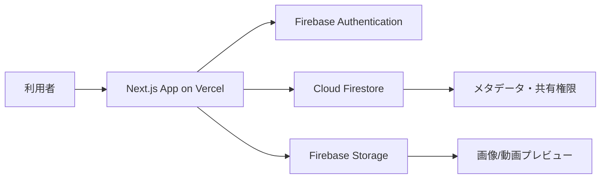

# 画像・動画共有アプリ構想メモ

作成者: **Manus AI**  
作成日: 2026-06-07

## 1. 結論

現時点の最有力案は、**Next.js + Vercel + Firebase Authentication + Firestore + Firebase Storage**でMVPを作る構成です。理由は、LINEで発生している「複数人への共有」「ダウンロード前提」「場所によってプレビューできない」「一元管理できない」という課題に対して、最小の学習コストで「アップロード」「一覧表示」「即時プレビュー」「共有リンク」「権限管理」まで到達できるからです。

ただし、動画を本格的に扱う場合、Firebase Storage単体は**保管場所**としては優秀でも、動画の変換、圧縮、サムネイル生成、ストリーミング最適化、端末ごとの再生互換性までは弱いです。Vercelも公式に、大きな動画ファイルは帯域消費が大きくなりやすく、Vercel Blob、S3 + CDN、Mux、Cloudinaryなどの専用ホスティング選択肢を検討することを推奨しています。[1]

したがって、私の所感としては、最初は**Firebase StorageでMVPを作る**のがよいです。その後、動画の量が増えたり、プレビュー品質や再生速度が問題になった段階で、**CloudinaryまたはMuxを追加する二段階構成**にするのが、学習面でも事業面でも失敗しにくい判断です。

| 判断軸 | 今すぐのおすすめ | 将来のおすすめ |
|---|---:|---:|
| フロントエンド | Next.js | Next.js継続 |
| デプロイ | Vercel | Vercel継続、必要なら一部Cloud Run |
| 認証 | Firebase Authentication | Firebase Authentication継続 |
| DB | Firestore | Firestore、必要ならPostgreSQL系へ移行 |
| 画像・動画保存 | Firebase Storage | Cloudinary、Mux、S3 + CDNを追加 |
| 目的 | 早く動くMVP | 高速プレビュー、変換、配信最適化 |

## 2. 現状課題の整理

現在の課題は、単に「画像や動画を送れるアプリが欲しい」というよりも、**LINEでの共有が業務・チーム利用に向いていない**ことにあります。LINEは会話を中心にしたツールなので、ファイルが会話の流れに埋もれやすく、後から探す、一覧で見る、誰に共有したか確認する、権限を管理する、といった用途では限界が出ます。

| 現状の課題 | アプリで解決すべきこと | MVPでの実装イメージ |
|---|---|---|
| LINE上でやり取りしている | メディアを会話から切り離して管理する | プロジェクト/アルバム単位の一覧画面 |
| 複数人数に送る必要がある | 共有先をグループ化する | 招待リンク、閲覧メンバー管理 |
| DLしないと見られない | ブラウザ上で即時プレビューする | 画像グリッド、動画プレイヤー |
| 場所によってプレビューできない | 端末・回線に依存しにくい表示にする | サムネイル、軽量プレビュー、圧縮版 |
| 一元管理したい | ファイル、投稿者、日時、タグを蓄積する | Firestoreにメタデータ保存 |

このアプリの価値は、SNSのような投稿体験ではなく、**関係者全員が同じ場所で画像・動画を確認できる共有台帳**にあります。最初からInstagramやGoogle Photosを目指す必要はなく、「LINEに流したファイルを探すストレスをなくす」ことに絞るべきです。

## 3. 最新トレンド案と将来トレンド案

プロジェクト方針として、現実的にすぐ作れる**最新トレンド案**と、今後伸びる可能性が高い**将来トレンド案**を分けて考えるのがよいです。

| 区分 | 案 | 内容 | 向いている段階 |
|---|---|---|---|
| 最新トレンド案 | Vercel + Firebase型MVP | Next.jsをVercelに置き、認証・DB・ストレージをFirebaseに寄せる | 今すぐ作る段階 |
| 将来トレンド案 | AIメディア管理型 | Cloudinary等のAIタグ付け、動画要約、顔/物体検索、サムネ自動生成を使う | 利用者やファイル量が増えた段階 |

最新トレンド案では、**ユーザーがアップロードしたファイルをすぐ一覧化し、ブラウザでプレビューできること**を最優先にします。Firebase StorageはWebアプリからFileやBlobをアップロードでき、`uploadBytesResumable`による進捗監視、一時停止、再開、キャンセルも扱えます。[2] これは動画のような大きめのファイルをアップロードするUXに向いています。

将来トレンド案では、単なるファイル共有から一歩進んで、**AIで探せるメディア管理アプリ**に寄せます。たとえば、「昨日のイベントの集合写真」「Aさんが写っている動画」「この商品が映っている素材」「未確認の動画だけ」といった探し方ができると、LINEや単純なクラウドストレージとの差別化になります。Cloudinaryは画像・動画の変換、最適化配信、AIを使ったメディア管理やモデレーションを提供しており、Firebase Storage単体で不足しがちな部分を補えます。[4]

## 4. 技術選定

言語は**TypeScript**をおすすめします。Java経験があるなら、型の考え方に慣れているはずなので、JavaScriptよりもTypeScriptの方が長期的には理解しやすいです。フレームワークは**Next.js**がよいです。Vercelとの相性が非常に高く、画像最適化やルーティング、API Routes/Server Actionsなどを段階的に学べるためです。

| 項目 | 推奨 | 理由 |
|---|---|---|
| 言語 | TypeScript | 型があり、Java経験から移行しやすい |
| フレームワーク | Next.js | Vercelとの相性がよく、MVPから拡張まで対応しやすい |
| UI | Tailwind CSS + shadcn/ui | 素早く見た目を整えられ、飽きずに進めやすい |
| 認証 | Firebase Authentication | Googleログイン、メールログイン等を早く導入できる |
| DB | Firestore | メディアのメタデータや共有権限を柔軟に保存できる |
| ストレージ | Firebase Storage | 初期構築が簡単で、Firebase AuthとSecurity Rulesを組み合わせやすい |
| デプロイ | Vercel | Next.jsの標準的なデプロイ先として扱いやすい |

Firebase Storageでは、本番環境で認証とSecurity Rulesによるアクセス制御が重要です。公式ドキュメントでも、ほとんどの本番アプリではアクセスを制限し、堅牢なセキュリティルールを設定することが強く推奨されています。[2]

> Cloud Storage for Firebaseの公式ドキュメントは、ほとんどの状況において、未認証アクセスではなく、アクセス制限と堅牢なセキュリティルールの設定を強く推奨しています。[2]

## 5. 推奨アーキテクチャ

MVP段階では、アプリ本体をVercelに置き、ユーザー認証、ファイル保存、メタデータ管理をFirebaseに寄せます。これにより、バックエンドを大きく作り込まずに、ユーザーが実際に触れる画面を早く完成させられます。

Firestoreには、ファイルそのものではなく、ファイルに関する情報を保存します。たとえば、ファイル名、Storageのパス、アップロード者、所属アルバム、共有先、作成日時、MIMEタイプ、サイズ、サムネイルURLなどです。実体ファイルはFirebase Storageに置き、画面ではFirestoreの一覧情報を取得してからStorageのURLを使って表示します。

| データ | 保存先 | 例 |
|---|---|---|
| ユーザー情報 | Firebase Auth / Firestore | uid、表示名、メール |
| アルバム情報 | Firestore | albumId、title、members |
| メディア情報 | Firestore | mediaId、fileName、storagePath、type、uploadedBy |
| 実体ファイル | Firebase Storage | `/albums/{albumId}/{mediaId}` |
| 共有権限 | Firestore / Storage Rules | owner、viewer、editor |

## 6. 機能の優先順位

最初に作るべき機能は、華やかなSNS機能ではありません。**アップロードして、一覧で見られて、共有できる**という最短ルートです。ここを先に通すと、学習の達成感も出やすく、途中で飽きにくくなります。

| 優先度 | 機能 | 理由 |
|---:|---|---|
| 1 | ログイン | 誰がアップロードしたか、誰に見せるかを管理するため |
| 2 | アルバム作成 | LINEの会話単位ではなく、目的単位で整理するため |
| 3 | 画像/動画アップロード | アプリの中心機能だから |
| 4 | グリッド表示・プレビュー | ダウンロードせずに確認する価値を出すため |
| 5 | 共有リンク | 複数人に送る課題を直接解決するため |
| 6 | 権限管理 | 見せてよい人だけに見せるため |
| 7 | 検索・タグ | ファイル量が増えた後に効いてくるため |
| 8 | サムネイル生成 | 動画が増えた後に必要になるため |

## 7. Firebase Storageだけで始める場合の注意点

Firebase StorageでMVPを作るのは良い選択ですが、動画共有アプリとして伸ばす場合には、いくつかの限界があります。特に動画は、撮影端末によって形式、解像度、ビットレートがばらばらになります。そのまま保存してそのまま表示すると、端末によって再生できない、読み込みが重い、通信量が増える、サムネイルが出ない、といった問題が起きます。

| 課題 | Firebase Storage単体での状態 | 対策 |
|---|---|---|
| 動画変換 | 基本的には自前実装が必要 | Cloudinary/Mux導入、またはCloud Functionsで処理 |
| サムネイル | 自動生成は別途必要 | アップロード時に生成処理を追加 |
| 配信最適化 | CDN的な配信は可能だが動画最適化は限定的 | 専用動画配信サービスを検討 |
| コスト管理 | 保存量・転送量に依存 | ファイルサイズ制限、圧縮、削除ポリシー |
| セキュリティ | Rules設計が必要 | albumId単位で権限設計 |

そのため、最初から完璧な動画基盤を作るより、**まずFirebase Storageで動かし、動画が重くなった時点でCloudinaryまたはMuxへ逃がせる設計**にしておくのがベストです。Firestoreに`provider`、`storagePath`、`previewUrl`、`thumbnailUrl`のようなフィールドを持たせておけば、後から保存先を変えても画面側の影響を小さくできます。

## 8. 代替案

もしVercel + Firebaseが難しい、または動画対応を最初から強くしたい場合は、次の代替案があります。

| 案 | 構成 | メリット | デメリット | おすすめ度 |
|---|---|---|---|---:|
| A | Next.js + Vercel + Firebase | 学習しやすくMVPが早い | 動画変換は弱い | 5 |
| B | Next.js + Vercel + Cloudinary | 画像・動画プレビューが強い | 認証やDBは別途必要 | 4 |
| C | Next.js + Vercel + Supabase Storage | SQLで管理しやすい | Firebaseより学習範囲が増える | 3 |
| D | Next.js + S3 + CloudFront | 本格運用向け | 初学者には設定が重い | 2 |
| E | Firebase App Hosting + Firebase | Firebase内でまとまる | Vercel好みからは外れる | 3 |

Vercel公式は、動画ホスティングの候補としてVercel Blob、Vimeo、S3 + BunnyCDN/CloudFront、Mux、Cloudinaryを挙げています。[1] そのため、「動画が中心のアプリ」に成長させるなら、Firebase Storageだけに固定せず、将来の動画基盤差し替えを前提にした設計が安全です。

## 9. MVPの画面構成

最初の画面構成は、次の5画面で十分です。これ以上増やすと、完成までの距離が伸びてモチベーションが落ちやすくなります。

| 画面 | 内容 | 最初の完成条件 |
|---|---|---|
| ログイン画面 | Googleログインまたはメールログイン | ログイン後にホームへ遷移できる |
| ホーム画面 | 自分が参加しているアルバム一覧 | アルバム名と更新日時が見える |
| アルバム詳細画面 | 画像・動画のグリッド表示 | クリックでプレビューできる |
| アップロード画面 | ファイル選択、進捗表示 | 画像・動画をStorageへ保存できる |
| 共有設定画面 | 招待リンク、メンバー表示 | 他人が同じアルバムを見られる |

デザインの方向性は、InstagramのようなSNSではなく、**Google PhotosとNotionの中間**がよいです。つまり、見た目は軽く、情報整理はしやすく、チーム共有に耐えるUIです。

## 10. AIに指示を出すためのプロンプト

次に開発者やAIに依頼するなら、以下のプロンプトが使えます。

> Next.js、TypeScript、Tailwind CSS、Firebase Authentication、Cloud Firestore、Firebase Storageを使って、画像・動画共有アプリのMVPを作ってください。目的は、LINE上で散らばっている画像・動画をアルバム単位で一元管理し、複数人がブラウザ上で即時プレビューできるようにすることです。最初に実装する機能は、Googleログイン、アルバム作成、画像・動画アップロード、アップロード進捗表示、アルバム内グリッド表示、画像プレビュー、動画再生、共有リンク、メンバー権限管理です。Firestoreにはファイル本体ではなく、mediaId、albumId、fileName、contentType、size、storagePath、downloadUrl、thumbnailUrl、uploadedBy、createdAt、providerを保存してください。Firebase Storageのパスは`/albums/{albumId}/{mediaId}/{fileName}`とし、Security Rulesでアルバムメンバーのみ読み書きできるようにしてください。将来的にCloudinaryやMuxへ移行できるよう、メディア表示コンポーネントはproviderごとにURL生成ロジックを分離してください。UIはGoogle PhotosとNotionの中間のような、シンプルで一覧性の高いデザインにしてください。

このプロンプトのポイントは、単に「画像共有アプリを作って」ではなく、**解決したい課題、技術スタック、データ設計、セキュリティ、将来拡張、UI方針**まで指定していることです。AIに作らせる場合でも、人間の開発者に依頼する場合でも、この粒度まで書くと手戻りが減ります。

## 11. 最初の開発ステップ

最初の1週間は、完成度よりも「触れるもの」を作ることを優先すべきです。ユーザーの性格的にも、抽象設計に時間をかけすぎるより、画面が動く状態を早く作った方が継続しやすいです。

| 日程 | やること | 完了条件 |
|---|---|---|
| Day 1 | Next.jsプロジェクト作成、Firebase接続 | ログイン画面が表示される |
| Day 2 | Firebase Authentication | Googleログインできる |
| Day 3 | アルバム作成とFirestore保存 | アルバム一覧が見える |
| Day 4 | Firebase Storageアップロード | 画像をアップロードできる |
| Day 5 | 動画アップロードと進捗表示 | 動画アップロードの進捗が見える |
| Day 6 | プレビューUI | 画像と動画をブラウザで見られる |
| Day 7 | 共有リンクの原型 | URLを知っている人が閲覧できる |

## 12. 最終提案

このアプリは、最初から大規模な動画SNSとして作るより、**LINEのファイル共有の不満を解消する小さな業務ツール**として始めるべきです。技術スタックは、現時点では**Next.js + TypeScript + Vercel + Firebase**が最適です。動画処理の限界だけは最初から意識し、Firestoreのデータ構造に`provider`や`thumbnailUrl`を持たせて、CloudinaryやMuxへ移行できる余地を残してください。

一言でまとめると、今作るべきものは**「LINEに流れて消える画像・動画を、チームで見返せる共有アルバムに変えるアプリ」**です。

## References

[1]: https://vercel.com/kb/guide/best-practices-for-hosting-videos-on-vercel-nextjs-mp4-gif "Vercel Knowledge Base: What are the best practices for hosting videos on Vercel?"
[2]: https://firebase.google.com/docs/storage/web/upload-files "Firebase Documentation: Upload files with Cloud Storage on Web"
[3]: https://firebase.google.com/docs/studio/deploy-app "Firebase Documentation: Publish your app with Firebase Studio"
[4]: https://cloudinary.com/ "Cloudinary: Image and Video API Platform"
