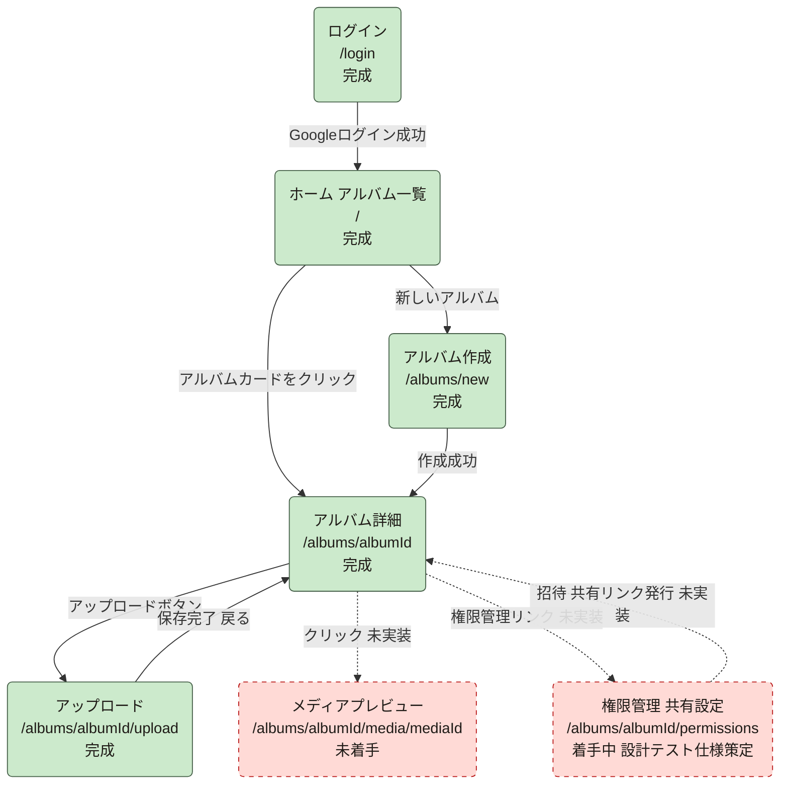

# tayori 開発進捗状況

| 項目 | 内容 |
|---|---|
| 最終更新日 | 2026-07-22 |
| 更新者 | writer |
| 更新ルール | PM→writer→developer→レビュワーのワークフローでタスクが完了するたびに、PMが本ファイルを更新する |

---

## 1. 画面単位の完成/未完成一覧

| No | 画面 | URL | 状況 | 補足 |
|---|---|---|---|---|
| 1 | ログイン | `/login` | ✅ 完成 | `src/app/(auth)/login/page.tsx` |
| 2 | ホーム（アルバム一覧） | `/` | ✅ 完成 | `src/app/page.tsx` |
| 3 | アルバム作成 | `/albums/new` | ✅ 完成 | `src/app/albums/new/page.tsx` |
| 4 | アルバム詳細 | `/albums/[albumId]` | ✅ 完成 | `src/app/albums/[albumId]/page.tsx` |
| 5 | アップロード | `/albums/[albumId]/upload` | ✅ 完成 | 2026-07-22 確定前プレビュー方式へ変更済み（コミット a3ec0ec） |
| 6 | メディアプレビュー単体画面 | `/albums/[albumId]/media/[mediaId]` | ❌ 未着手 | `MediaCell`の`onSelect`は実装済み、遷移先ページ未実装 |
| 7 | 権限管理（共有設定） | `/albums/[albumId]/permissions` | ⚠️ 着手中（設計・テスト仕様策定フェーズ）| 基本設計書 v1.9（4.8/5.1/6.6/6.7/7.1）・テスト仕様書 v1.7（5.33〜5.41）で設計・テスト仕様を策定済み。実装（TDD）はこれから。`pendingInvites` サブコレクション方式・メール事前登録→ログイン時受諾・招待取り消しを定義 |

## 2. MVP機能単位の完成/未完成一覧

| MVP機能 | 状況 | 補足 |
|---|---|---|
| 1. Googleログイン | ✅ 完成 | |
| 2. アルバム作成・一覧 | ✅ 完成 | |
| 3. 画像/動画アップロード（進捗表示） | ✅ 完成 | 確定前プレビュー方式まで反映済み |
| 4. グリッド表示・プレビュー | ⚠️ 一部完成 | グリッド表示は完成。クリックでの単体プレビュー画面は未実装 |
| 5. 共有リンク | ⚠️ 着手中（設計・テスト仕様策定フェーズ）| 権限管理画面の InviteModal ①URLコピー導線として設計済み（基本設計書6.6）。実装は権限管理画面と同時進行 |
| 6. 閲覧権限管理 | ⚠️ 着手中（設計・テスト仕様策定フェーズ）| Security Rulesはデプロイ・動作確認済み。owner以外を招待する編集UI（`pendingInvites` 方式・メール事前登録→受諾・招待取り消し）を基本設計書 v1.9・テスト仕様書 v1.7 で設計。Rules の `isAlbumAdmin`/`isAcceptingOwnInvite` 追加とユニットテスト（RUL-01〜07）はこれから実装 |

## 3. 画面遷移図

実線＝実装済みの遷移、破線＝設計上は定義されているが未実装の遷移。

## 4. テスト仕様の整備状況

`docs/テスト仕様書.md`（v1.7時点）は画面1〜5（ログイン/ホーム/アルバム作成/アルバム詳細/アップロード）のテストケースが定義・実装済み。**画面6（権限管理 / 共有設定）と Firestore Security Rules のテストケース（§5.33〜5.41: FP/UPI/UAI/MR/IM/PT/AR/PMT/PP/ADP-09〜11/RUL）は v1.7 で新規定義済み・実装（TDD）は未着手**。メディアプレビュー単体画面は引き続き「次フェーズ対象」の記載のみでテストケース未作成。

## 5. 次に着手すべき箇所（優先順位）

| 優先度 | 項目 | 理由 |
|---|---|---|
| 1 | 権限管理画面（`/permissions`）| **設計・テスト仕様は策定完了（基本設計書 v1.9・テスト仕様書 v1.7）。次はdeveloperによるTDD実装フェーズ**。owner以外を招待する手段がなく「チームで一元管理」という核心価値が未検証。共有リンクもこれに依存 |
| 2 | メディアプレビュー単体画面 | `MediaCell`のクリックハンドラは実装済みで、遷移先ページ追加のみで完了に近づく |
| 3 | 共有リンク発行UI | 権限管理画面内に統合実装が効率的 |
| 4 | `src/lib/mediaUrl.ts`（provider分岐） | 将来のCloudinary/Mux移行に備えた安全弁。メディアプレビュー実装と合わせてでよい |
| 5 | 共通レイアウト（SideNav/TopHeader/BottomNav） | 設計上も意図的に後回し。MVP機能が揃ってからでよい |

## 6. リスク・確認事項

- 権限管理画面が無い状態では、Security Rulesの`memberUids`判定に対してownerしか追加できず、実質的に単独ユーザー専用アプリの状態
- 直近のアップロード画面変更はコミット済み（`a3ec0ec`）だが、push未実施。push要否はユーザー判断
- ファイル単位ではBranchカバレッジがやや基準未達の箇所がある（`upload/page.tsx`単体Branch 85%、`templates`層全体Branch 86.66%）。全体では90%基準を達成しているため重大リスクではない

## 7. 更新履歴

| 日付 | 内容 |
|---|---|
| 2026-07-22 | 初版作成。アップロード画面の確定前プレビュー方式への変更完了を反映 |
| 2026-07-22 | 権限管理（共有設定）の設計・テスト仕様策定に着手。画面6・共有リンク・閲覧権限管理を「⚠️ 着手中（設計・テスト仕様策定フェーズ）」へ更新。基本設計書 v1.9（4.8/5.1/6.6/6.7/7.1）・テスト仕様書 v1.7（5.33〜5.41）を策定。`pendingInvites` サブコレクション方式、メール正規化統一、招待受諾バッチ、招待取り消し（確定メンバー削除は次フェーズ）、Rulesユニットテスト7項目を定義。実装（TDD）は未着手 |
