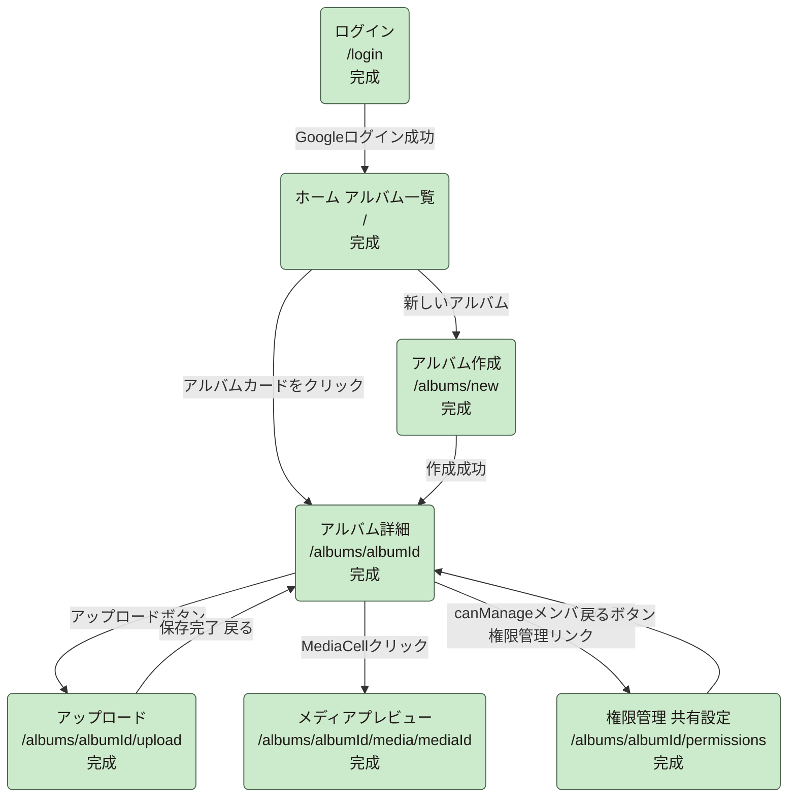

# tayori 開発進捗状況

| 項目 | 内容 |
|---|---|
| 最終更新日 | 2026-07-23 |
| 更新者 | PM |
| 更新ルール | PM→writer→developer→レビュワーのワークフローでタスクが完了するたびに、PMが本ファイルを更新する |

---

## 1. 画面単位の完成/未完成一覧

| No | 画面 | URL | 状況 | 補足 |
|---|---|---|---|---|
| 1 | ログイン | `/login` | ✅ 完成 | `src/app/(auth)/login/page.tsx` |
| 2 | ホーム（アルバム一覧） | `/` | ✅ 完成 | `src/app/page.tsx` |
| 3 | アルバム作成 | `/albums/new` | ✅ 完成 | `src/app/albums/new/page.tsx` |
| 4 | アルバム詳細 | `/albums/[albumId]` | ✅ 完成 | `src/app/albums/[albumId]/page.tsx`。MediaCellクリックで`/media/[mediaId]`へ遷移でき、権限管理リンクは`myMember.canManage`のメンバーにのみ表示（二重防御として`permissions/page.tsx`側にも独立ガードあり） |
| 5 | アップロード | `/albums/[albumId]/upload` | ✅ 完成 | 確定前プレビュー方式へ変更済み（コミット a3ec0ec） |
| 6 | メディアプレビュー単体画面 | `/albums/[albumId]/media/[mediaId]` | ✅ 完成 | `src/app/albums/[albumId]/media/[mediaId]/page.tsx`実装完了。認証→アルバム存在確認→memberUids判定（非メンバー403相当）→media存在確認（404相当）の順にガードし、`getPreviewUrl`（`src/lib/mediaUrl.ts`）でprovider分岐を吸収。画像は``+`object-contain`、動画は`<video controls preload="metadata">` |
| 7 | 権限管理（共有設定） | `/albums/[albumId]/permissions` | ✅ 完成 | コミット `31f1d4f` で実装完了。三段ガード（認証→アルバム読込→`myMember.canManage`）、`useAcceptInvite`による招待自動受諾、招待作成/取消/権限更新、確定メンバー権限保存を実装。アルバム詳細画面から`canManage`メンバー向けのリンク導線を追加済み |

## 2. MVP機能単位の完成/未完成一覧

| MVP機能 | 状況 | 補足 |
|---|---|---|
| 1. Googleログイン | ✅ 完成 | |
| 2. アルバム作成・一覧 | ✅ 完成 | |
| 3. 画像/動画アップロード（進捗表示） | ✅ 完成 | 確定前プレビュー方式まで反映済み |
| 4. グリッド表示・プレビュー | ✅ 完成 | クリックで単体プレビュー画面へ遷移し、画像/動画をブラウザ上で即時表示できる |
| 5. 共有リンク | ✅ 完成 | 権限管理画面`InviteModal`の①URLコピー導線として実装済み（`navigator.clipboard.writeText`） |
| 6. 閲覧権限管理 | ✅ 完成 | Firestore Security Rules（`isAlbumAdmin`/`isAcceptingOwnInvite`/`adminUids`）実装済み。権限管理画面（招待・権限編集・招待取消）実装完了。アルバム詳細画面からの導線も追加済み |

**MVP機能6項目・5画面構成（+補助2画面）すべて完成。**

## 3. 画面遷移図

すべての遷移が実装済み（実線）。

## 4. テスト仕様の整備状況

`docs/テスト仕様書.md`（v1.9時点）は画面1〜7（ログイン/ホーム/アルバム作成/アルバム詳細/アップロード/権限管理/メディアプレビュー）すべてのテストケースが定義・実装済み。

## 5. 次に着手すべき箇所（優先順位）

| 優先度 | 項目 | 理由 |
|---|---|---|
| 1 | MVP全体の手動動作確認 | ログイン→アルバム作成→アップロード→プレビュー→権限管理の一連の流れを実際のブラウザで確認 |
| 2 | 共通レイアウト（SideNav/TopHeader/BottomNav） | 設計上意図的に後回しにしていたが、MVP機能が揃ったため着手を検討できる |
| 3 | リンター導入の検討 | `eslint-plugin-security`等の一般的な脆弱性検知ツール導入、Firestore Rulesテストの生ログ自動チェックのCI組み込み |
| 4 | フェーズ2以降の機能（招待メール送信、確定済みメンバー削除、権限変更履歴等） | MVPスコープ外として先送りしていた機能群 |

## 6. リスク・確認事項

- 直近の権限管理・メディアプレビュー実装はコミット未実施（本ドキュメント更新時点）。push未実施。push要否はユーザー判断
- 基本設計書§4.9のコード例のCSSクラス表記が実装と字面のみ異なる（機能・セキュリティに影響しない非ブロッキングの指摘、次回改訂時にwriterが追従予定）

## 7. 更新履歴

| 日付 | 内容 |
|---|---|
| 2026-07-22 | 初版作成。アップロード画面の確定前プレビュー方式への変更完了を反映 |
| 2026-07-22 | 権限管理（共有設定）の設計・テスト仕様策定に着手。画面6・共有リンク・閲覧権限管理を「⚠️ 着手中」へ更新 |
| 2026-07-23 | 権限管理画面の実装完了（コミット `31f1d4f`）を反映。画面7・MVP機能5・6を「✅ 完成」へ更新。実コード調査により「メディア詳細クリックで404」「アルバム詳細から権限管理への導線UIが無い」を新規リスクとして追加 |
| 2026-07-23 | メディアプレビュー単体画面（`/media/[mediaId]`）とアルバム詳細→権限管理画面のUI導線を実装完了。レビュワー一発承認。画面6・MVP機能4を「✅ 完成」へ更新し、画面4の404不具合・画面7の導線欠落リスクを解消済みとして記載を削除。**MVP機能6項目・5画面構成（+補助2画面）が全て完成** |
